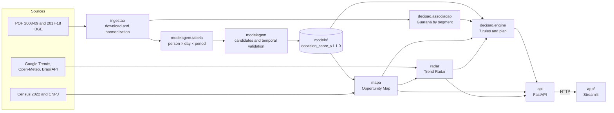

# Occasion Intelligence: Pizza + Guaraná

[Português](README.md) · English

A data system that estimates **when, where and for whom** the pizza-with-soda occasion is most likely and turns that estimate into an **activation recommendation** for Guaraná Antarctica, with the reason, the plan and the source of every number. Built for the Inteli × Ambev case (TAPI).

The score comes from a model trained on IBGE's POF microdata and validated out of time. The recommendation comes from written rules, not a second model, because there is no history of actions and outcomes from which to learn an activation's effect. The API exposes the case's contract, and the Streamlit app only talks to it.

- **Occasion Score**: calibrated probability (0 to 100) of eating pizza with soda in a meal period, with a 95% interval and a per-factor explanation.
- **Decision Engine**: seven ordered rules that pick the activation category from the score, Guaraná's association in the segment and the channel, plus an activation plan (who, where, when, channel, creator, mechanic and measurement).
- **Case extras**: Opportunity Map (319 prioritized municipalities) and Trend Radar (weekly search alert by state).

## Problem and scope

Ambev wants to raise how often Guaraná is consumed on the pizza occasion, avoiding the obvious (joint supermarket promotions). The audience is aged 20 to 44, men and women, classes A to D, with class A dominating today and expansion aimed at B to D. Ambev does not share data (LGPD), so the project uses public data only.

Scope:

- **Occasion**: pizza with soda in the same meal period. Guaraná alone has too few occasions for a model (185 of 811 in 2017-18). The model estimates the occasion Guaraná competes for, and Guaraná's presence enters the Engine by segment.
- **Unit**: person × recorded day × meal period (morning, lunch, afternoon, night).
- **Prediction time**: before the meal period, using only profile, place and calendar.
- **Territory**: all of Brazil, with region and area type as features. The Map goes down to the municipality.

## Data

Full sheet in the [Data Card](docs/data_card.md) (Portuguese); exploratory analysis in [`notebooks/eda_occasion_score.ipynb`](notebooks/eda_occasion_score.ipynb).

- **Target source**: POF 2008-09 (267,612 rows, 668 occasions) and POF 2017-18 (340,072 rows, 811 occasions), Individual Food Consumption, IBGE. It is the only national public source with what each person ate and drank, on which weekday and at what time, with sample weights.
- **Target**: pizza and soda (generic or branded) within 1 hour of each other in the meal period. The 1-hour window was chosen against the declared meal type.
- **Weights**: POF sample weight, with each weekday counting 1/7.
- **Left out of the model**: meal location, meal type, atypical day and items consumed (leakage). Google Trends was tested as a feature, tied with region and was left out: it measures interest, not consumption.
- **Extras' sources**: Census 2022 (IBGE), CNPJ (Receita Federal), OpenStreetMap, Google Trends, Open-Meteo and BrasilAPI.

## Architecture

Details in [`docs/architecture.en.md`](docs/architecture.en.md).



| Layer | Technology | Why |
|---|---|---|
| Ingestion | Python, urllib, IBGE's official SAS layout | the microdata is fixed-width, shipped with SAS reading programs |
| Data | pandas, Parquet | the volume fits in memory (1.2 million consumption items in 2017-18) |
| Model | scikit-learn (logistic with splines, Platt), LightGBM, FLAML | candidates of increasing capacity; the choice is made by experiment |
| Explanation | exact linear SHAP of the logistic model | each feature's contribution is closed-form and adds up to the score's logit |
| Service | FastAPI + Pydantic | validated input and output contract |
| Interface | Streamlit + pydeck + Altair | simulator, map and radar on top of the API |
| Reproducibility | uv (lock), pytest, ruff, GitHub Actions | pinned environment and tests in CI |

## Installation and usage

Requirements: [uv](https://docs.astral.sh/uv/) (it installs the Python 3.14 pinned in `.python-version`) and about 3 GB free if you rebuild the pipeline.

### App and API (no data download)

The trained model (`models/`) and the reference tables (`data/referencia/`) are versioned, so the demo runs straight from a clone:

```bash
uv sync
./app/rodar.sh
```

The script starts the API at http://localhost:8000 (interactive docs at `/docs`) and the app at http://localhost:8501. To start them separately:

```bash
uv run uvicorn occasion.api.app:app --port 8000
OCCASION_API_URL=http://localhost:8000 uv run streamlit run app/streamlit_app.py
```

Example call:

```bash
curl -X POST http://localhost:8000/predict -H "Content-Type: application/json" -d '{
  "turno": "noite", "dia_semana": 6, "regiao": "Sudeste", "tipo_area": "capital",
  "faixa_idade": "25-29", "sexo": "mulher", "renda_sm": 5, "canal": "delivery"
}'
```

The response follows the case's contract (`occasion_score`, `classification`, `top_factors`, `recommendation_category`, `recommendation_reason`, `model_metadata`) and adds the applied rule, the channel, the messages, the segment's association, the activation plan, the best moment of the week, the position within the class, the uncertainty, the sources and the limitations.

| Route | Returns |
|---|---|
| `POST /predict` | score, band, factors, recommendation, plan, uncertainty, sources and limitations |
| `GET /model` | model metadata, temporal-validation metrics and limitations |
| `GET /opcoes` | accepted values for each input field |
| `GET /mapa` | Opportunity Map municipalities |
| `GET /radar`, `GET /radar/{UF}` | Trend Radar alerts and the state's weekly series |
| `GET /health` | status and model version |

### Full pipeline (reproduces the numbers)

```bash
uv run python -m occasion.ingestao.download       # POF microdata from IBGE's FTP (~2.3 GB)
uv run python -m occasion.ingestao.pof            # harmonized consumption for both editions
uv run python -m occasion.modelagem.tabela        # modeling table
uv run python -m occasion.modelagem.experimentos  # baseline, logistic, LightGBM and ablation
uv run --group automl python -m occasion.modelagem.candidatos  # candidates and AutoML
uv run python -m occasion.modelagem.final         # served model (models/)
uv run python -m occasion.modelagem.incerteza     # 200 bootstrap replicas for the 95% CI (~10 min)
uv run python -m occasion.modelagem.avaliacao     # importance, bands, segments and errors
uv run python -m occasion.decisao.associacao      # Guaraná by segment (data/referencia/)
uv run --group sintetico --group eda python -m occasion.modelagem.sintetico  # synthetic data (~40 min)
```

Generated reports go to `data/processed/`; the copies used in this delivery are in [`docs/relatorios/`](docs/relatorios/). The Opportunity Map has its own pipeline (Census 2022, CNPJ and OSM, `mapa` group; see the docstring of `occasion.mapa.oportunidade`). The Trend Radar reads the versioned collections and runs without downloading anything:

```bash
uv run python -m occasion.radar.radar     # alerts (data/referencia/radar_alertas.json) and report
# redo the collections (optional): occasion.radar.trends, occasion.radar.clima, occasion.radar.feriados
```

EDA:

```bash
uv run --group eda jupytext --to ipynb --set-kernel python3 --execute notebooks/eda_occasion_score.py
```

### Tests

```bash
uv run pytest -m "not dados"   # runs in CI, without the microdata
uv run pytest                  # includes tests on the real microdata
uv run ruff check && uv run ruff format --check
```

## Models and configuration

Full sheet in the [model card](docs/model.en.md).

- **Model**: logistic regression with one-hot categoricals and splines on the income percentile, calibrated with Platt on out-of-sample 2017-18 predictions.
- **Features** (7): meal period, weekday, region, area type, age band, sex and household income percentile.
- **Per-group correction** (v1.1.0): a logit offset for the Northeast, Center-West and rural areas, the groups where the score got the level wrong out of sample and where the correction improves calibration on tracts it did not see.
- **Bands**: high (top 10% of scores in the 2017-18 population), medium (10% to 30%) and low (the rest).
- **Explanation**: linear SHAP on the calibrated logit, per prediction, and permutation importance in temporal validation.
- **Uncertainty**: 95% CI by census-tract bootstrap, 200 replicas of the whole served-model pipeline.

### Choices relative to the case's suggestions

| Case suggestion | What the project uses | Why |
|---|---|---|
| Ambev or partner data | Public data only: POF, Census, CNPJ, OSM, Trends | Ambev does not share data (LGPD) |
| A baseline and a stronger model | Day × period baseline; logistic, LightGBM, Random Forest and AutoML as candidates | the logistic tied with LightGBM out of time, and the simplicity rule picks the simpler one |
| Temporal validation | Train on POF 2008-09, test on POF 2017-18 | both editions share the same food diary, nine years apart |
| SHAP | Exact linear SHAP of the logistic | with a linear model, the explanation is exact and needs no sampling |
| Google Trends as a signal | Tested as a feature and kept out of the score; used in the Trend Radar | tied with region in the ablation and measures interest, not consumption |
| FastAPI and Streamlit | FastAPI and Streamlit, with the app only over HTTP | it is the case's layered architecture |
| Extras: Trend Radar, Opportunity Map, Price Lab | Trend Radar and Map delivered; no Price Lab | the POF food diary does not record the price of each consumption |

### How the final model was chosen

1. **Candidates**: with the same 7 features and training on 2008-09, we compared the logistic, the logistic with a period × day interaction, a regularized LightGBM, a Random Forest and an AutoML run (FLAML, 900 s). Hyperparameters came from cross-validation grouped by census tract within 2008-09.
2. **Selection rule**, fixed before looking at the results: highest PR-AUC on the selection half of the 2017-18 tracts; if the difference to a simpler candidate has a 95% CI containing zero, the simpler one stays. The other half only measures.

   | Candidate | PR-AUC selection | PR-AUC evaluation | Difference to the logistic (95% CI) |
   |---|---:|---:|---|
   | **Logistic (chosen)** | 0.0316 | **0.0274** | |
   | Logistic + period × day | 0.0327 | 0.0279 | +0.0007 (−0.0004 to +0.0025) |
   | Regularized LightGBM | 0.0288 | 0.0266 | −0.0008 (−0.0050 to +0.0047) |
   | AutoML (FLAML, lgbm) | 0.0257 | 0.0231 | −0.0044 (−0.0150 to +0.0048) |
   | Random Forest | 0.0250 | 0.0211 | −0.0066 (−0.0171 to +0.0055) |

3. **Ablation**: `tem_crianca`, `n_moradores`, Trends × region and grouped weekday were dropped because they did not change PR-AUC (paired tract-bootstrap 95% CI crossing zero).
4. **Served model**: the chosen logistic, refit on both editions, with Platt and the per-group correction estimated on out-of-sample 2017-18 predictions.

Reports (Portuguese): [experiments](docs/relatorios/experimentos_occasion_score.md) and [candidates](docs/relatorios/candidatos_occasion_score.md).

## Methodology

- **Hypothesis**: profile, place and calendar rank meal periods by the occasion's likelihood better than the day × period pattern alone. Null hypothesis: the model does not beat the day × period baseline. Test: out-of-time PR-AUC difference, with a 95% CI from a paired tract bootstrap.
- **Baseline (no ML)**: weighted historical rate by weekday × period, the brief's "Friday night is good for pizza".
- **Primary metric, PR-AUC**: the occasion happens in 0.33% of periods, and with so many negatives ROC-AUC stays high even for weak models. A false positive costs a low-relevance activation; a false negative, a missed occasion. PR-AUC measures that balance in the ranking. We also report ROC-AUC, lift and recall in the top 10%, precision, recall and F1 at the threshold, the confusion matrix and calibration.
- **Cluster uncertainty**: every 95% CI comes from a census-tract bootstrap, the cluster of the POF sample.
- **Synthetic data**: a controlled experiment to see whether synthetic rows in training improve the model out of time (tabular VAE, SMOTE-NC and controls), with the rule fixed beforehand.

## Results

Temporal validation (train 2008-09, test 2017-18). Reproduced by `occasion.modelagem.final.metricas_temporais`.

| Metric | Baseline (day × period) | Final logistic |
|---|---:|---:|
| PR-AUC | 0.0182 | **0.0288** |
| ROC-AUC | 0.880 | **0.899** |
| Lift in top 10% | 5.8× | **6.9×** |
| Recall in top 10% | 58% | **69%** |

- **Gain over the baseline**: +0.011 PR-AUC (95% CI +0.005 to +0.019).
- **Calibration**: mean predicted 0.327% versus 0.327% observed; Brier 0.00321.
- **Importance** (PR-AUC drop when shuffled): meal period 80%, weekday 29%, income 19%, age band 13%, region 5%.
- **Bands**: the high band (10% of the population) holds 69% of occasions; medium (20%), 24%; low (70%), 7%.
- **Segments**: the model beats the baseline on every weekday and in every region.

### Per-group correction

Measured out of sample in 2017-18, the score got the level wrong for the Northeast (predicted ÷ observed 0.68, 95% CI 0.54 to 0.85), the Center-West (1.42) and rural areas (1.63). The served score adds a logit offset for those groups. Measured on halves of tracts the correction did not see, the ratios become 0.99, 1.01 and 1.04, improving in all 20 splits tested. Recall in the top 10% rises from 70.1% to 71.7%, and PR-AUC ties (0.0312 versus 0.0313).

Class D is not corrected because it is calibrated (0.95, 95% CI 0.71 to 1.35). It holds occasions the national cut-off misses because the occasion is less frequent there, so the API also shows the score's position within the class. Report (Portuguese): [group bias](docs/relatorios/vies_por_grupo.md).

### Synthetic data

No arm passed the rule fixed beforehand. The best came within +0.0012 PR-AUC of the real-data-only model (0.0274), with no 95% CI above zero, and the VAE did not even beat random labels. SMOTE-NC led on the selection half (0.0349 versus 0.0316) and dropped on the evaluation half (0.0239): more data is not better data. The served model did not change. Report (Portuguese): [synthetic data](docs/relatorios/dados_sinteticos.md).

### Where the model fails

- **Level by group**: before the correction, the Northeast was underestimated and the Center-West and rural areas overestimated (see above).
- **Class A**: overestimated in temporal validation (predicted ÷ observed 1.92), with few occasions and a wide interval.
- **Additive model**: the best day and period is the same for every profile (Saturday night). The interactions tested did not win out of time, so context variation lives in the Engine.

Full report (Portuguese): [evaluation, segments and errors](docs/relatorios/avaliacao_occasion_score.md).

## Decision Engine

Takes the score, the context and the factors and applies seven ordered rules (the first that holds decides). The category depends on the score, the channel and Guaraná's association with pizza in the segment, as section 7 of the case asks.

| Rule | Condition | Category | Why |
|---|---|---|---|
| 1 | low band outside the night | no activation | 93% of occasions are at night |
| 2 | high band and low brand presence in the segment (South, class B) | awareness and association with creators | Guaraná is already weak in soda in general there |
| 3 | high band and an association gap in the segment (North, Northeast, state capitals) | conversion: bring Guaraná to the pizza | Guaraná is strong in everyday soda and disappears at pizza |
| 4 | high band, no association signal | delivery → delivery activation; pizzeria → in-pizzeria action; at home or no channel → at-home combo | 66% of occasions are at home (delivery included) |
| 5 | the same profile reaches the high band at its best day and period | build frequency on the best Monday-to-Thursday night | there is affinity in the profile; that the action creates new consumption is a hypothesis |
| 6 | medium band and (low presence, gap or class B to D) | awareness and association with the segment's creators | B to D add up to 86% of occasions; class A, 5% |
| 7 | the rest | no activation (monitor) | |

### Guaraná association by segment

[`decisao/associacao.py`](src/occasion/decisao/associacao.py), stored in [`associacao_guarana.json`](data/referencia/associacao_guarana.json): Guaraná's share of soda occasions in general and of pizza-with-soda occasions, 20–44 audience of POF 2017-18, with 95% CIs from a tract bootstrap (1,000 replicas).

| Segment | Guaraná in soda in general | Guaraná at pizza | Gap (points, 95% CI) | Pizza occasions | Reading |
|---|---|---|---|---:|---|
| North | 33.7% | 7.9% | +25.9 (12.3 to 38.6) | 63 | gap |
| Northeast | 30.4% | 16.6% | +13.9 (5.7 to 20.7) | 147 | gap |
| state capital | 20.9% | 11.9% | +9.0 (1.6 to 15.3) | 163 | gap |
| South | 17.5% (13.8 to 22.0) | 21.4% | −3.9 (−18.8 to 7.7) | 81 | low presence |
| class B | 14.3% (10.2 to 19.9) | 21.5% | −7.2 (−24.5 to 7.1) | 65 | low presence |
| Brazil | 25.3% (22.9 to 27.8) | 21.1% | +4.2 (−3.3 to 11.2) | 444 | |

Criteria fixed in code: gap = 95% CI above zero and at least 60 pizza occasions; low presence = the segment's whole 95% CI below the national 95% CI. Rural (33 occasions) and class E (44) are left out for sample size, and the 30–34 age band passes at the edge and is left out (17 comparisons). When low presence and a gap occur together, low presence wins. The association is inferred from Guaraná's share, not measured by a brand survey.

### Activation plan

Every recommendation with an activation comes with a plan ([`decisao/plano.py`](src/occasion/decisao/plano.py)). The plan does not change the rule; it details the decision with measured data:

| Field | Where it comes from |
|---|---|
| Who | the context's profile, the segment that triggered the rule, the percentile within the class |
| Where | the region's 3 highest-priority cities from the Opportunity Map (capitals if the area is a capital; rural areas get no list) |
| When | day and period; at night, 7 to 9 pm (70.9% of occasions start then, 95% CI 61.9 to 79.4); in rule 5, the best Monday-to-Thursday night; the state's upcoming weeks with holidays (Trend Radar, informational) |
| Channel | the given channel; without one, "at home" only where the 95% CI of the region's at-home share is above 50% (Southeast and South), otherwise home and pizzeria |
| Creator | a creator profile by category and region ([`perfis_criadores.json`](data/referencia/perfis_criadores.json)): regional food, micro, for conversion in the North and Northeast (73% of northeasterners follow regional creators, Influency.me/Opinion Box 2025); urban food reviews for conversion elsewhere; entertainment with reach for awareness; everyday food, nano to micro, for building frequency. Market figures come from secondary sources; examples without contract checks |
| Mechanic and message | one per category, labeled as hypotheses |
| Measurement | indicator and the segment's POF baseline; no target, because there is no effect data |

### Uncertainty, sources and limitations

Each response says how much to trust the score, without changing the rule (the rule uses the point score):

- **`uncertainty.occasion_score_ic95`**: 95% interval from a tract bootstrap, 200 replicas that redo the logistic, Platt and offsets. In 2017-18, the mean half-width is 48% of the score in the high band, 62% in the medium band and 97% in the low band.
- **`uncertainty.faixa_estavel` and `prob_faixa`**: when the 95% CI crosses a band cut-off, the response warns "uncertain band". In 2017-18 the warning appears in 46% of high-band cases and 54% of medium-band cases. That is the real size of the uncertainty with 811 occasions.
- **`uncertainty.poucos_dados`**: an input value with fewer than 30 real occasions across both editions. Today no value falls below (the smallest is morning, with 35).
- **`sources`**: source, year and link for every number in the reason.
- **`limitations`**: what the model does not know.

The interval only measures the POF sample's variation. It does not cover habit changes since 2017-18 or model misspecification.

## Opportunity Map

A case extra. It applies the model, without retraining, to the 20–44 audience of the 319 municipalities with 100k+ inhabitants (Census 2022) and crosses it with the supply of active pizzerias in the CNPJ registry (17,271 in those municipalities, out of 25,474 nationwide). Four rules: high potential and high supply → neighborhood pizzeria (64 municipalities); high potential and low supply → delivery and creators (28); medium potential with a B-to-D majority → awareness (164); the rest → monitor (63). Report (Portuguese): [opportunity map](docs/relatorios/mapa_oportunidade.md).

## Trend Radar

A case extra. It tells whether interest in pizza is rising or falling in each state and what explains the movement. Searches measure interest, not consumption: the Radar does not enter the Occasion Score.

- **Signal**: Google Trends, "pizza", Food & Drink category, 5 years, by state and week. AC, AP and RR are left out for insufficient volume.
- **Trend**: last 4 weeks against the same weeks of the previous year, with the state's own noise band.
- **Factors**: panel regression on calendar (holidays, Carnival, Christmas and New Year, Pizza Day, start of the month) and the capital's weather. Carnival (+24 percentage points, 95% CI 21 to 27), Christmas and New Year (+18) and holiday weeks (+7) are associated with more searches; Pizza Day and weather are indistinguishable from zero.
- **Out-of-time validation** (train through 2024, test 2025-2026): the model does not significantly beat the "same as last year's average" baseline (0.5-point gain in mean error, 95% CI −0.3 to 1.3). The Radar works as a trend detector and a calendar of windows, not as a weekly forecast.
- **Alert**: a rule that crosses the trend with the Opportunity Map. Report (Portuguese): [trend radar](docs/relatorios/trend_radar.md).

## Limitations

- The latest data is POF 2017-18, before the pandemic and the delivery boom. Checks against Google Trends and iFood releases from 2024 to 2026 confirmed the night and weekend pattern, but the rate's level may have changed. POF 2024-25 has no microdata yet.
- The POF does not separate delivery or record dates; channel, weather and holidays do not enter the model.
- 811 occasions in 2017-18: fine segments (class A, Saturday, rural) have wide intervals.
- The per-group correction was chosen on the full data; the offsets are a measured improvement, not an exact one.
- The model is additive: the best day and period is the same for every profile.
- Guaraná's association is inferred from consumption share, not a brand survey, and has a small sample at pizza.
- Market figures in the creator profiles come from articles that cite the surveys, and the examples had no contract check.
- Messages, mechanics and rule 5 carry hypotheses labeled as such; no recommendation claims a causal effect.

## Next steps

- Retrain and revalidate on the POF 2024-25 microdata once published.
- Measure the activations' effect with a city-level controlled test (the Map already lists comparable cities), replacing hypotheses with measured effects.
- Price Lab, with a per-occasion price source (the POF diary has none).
- Delivery data from a partner, to separate delivery from home consumption.
- Check creators' contracts and availability with an agency and replace the profiles with validated names.
- Store a hash of the coefficients with the interval replicas, to reject replicas from another training run with the same version.

## Documentation

- [Architecture](docs/architecture.en.md): context, containers, pipeline, code map, invariants and decisions.
- [Model card](docs/model.en.md): intended use, metrics, results, ethics and caveats.
- [Data Card](docs/data_card.md) (Portuguese): sources, integration rules, anti-leakage, biases and license.
- [Reports](docs/relatorios/) (Portuguese): experiments, candidates, evaluation, group bias, synthetic data, map and radar.

## Repository layout

```
app/                    Streamlit app (API client) and rodar.sh
data/referencia/        small versioned public tables (association, creators, map, radar)
docs/                   architecture, model card, Data Card and reports
models/                 served model and interval replicas
notebooks/              EDA (.py source and executed notebook)
src/occasion/ingestao/  POF microdata download and reading
src/occasion/modelagem/ table, candidates, final model, uncertainty and evaluation
src/occasion/decisao/   Decision Engine, association, plan, creators and sources
src/occasion/mapa/      Opportunity Map
src/occasion/radar/     Trend Radar
src/occasion/api/       FastAPI API
tests/                  pytest (tests marked `dados` use the microdata)
```
