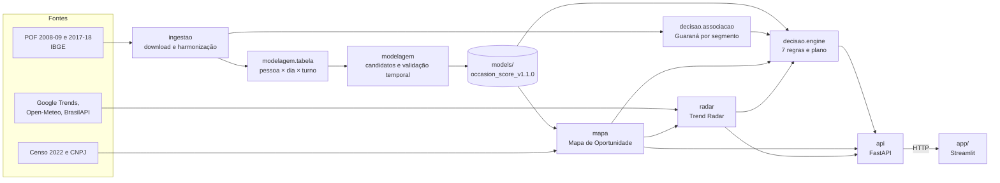

# Occasion Intelligence: Pizza + Guaraná

Português · [English](README.en.md)

Sistema de dados que estima **quando, onde e para quem** a ocasião pizza com refrigerante é mais provável e transforma essa estimativa numa **recomendação de ativação** para o Guaraná Antarctica, com o motivo, o plano e a fonte de cada número. Projeto do case Inteli × Ambev (TAPI).

O score vem de um modelo treinado nos microdados da POF/IBGE e validado fora do tempo. A recomendação vem de regras escritas, não de um segundo modelo, porque não há histórico de ações e resultados para aprender o efeito de uma ativação. A API expõe o contrato do case, e o app Streamlit só conversa com ela.

- **Occasion Score**: probabilidade calibrada (0 a 100) de comer pizza com refrigerante num turno, com intervalo de 95% e explicação por fator.
- **Decision Engine**: sete regras em ordem que escolhem a categoria de ativação pelo score, pela associação do Guaraná no segmento e pelo canal, e um plano de ativação (para quem, onde, quando, canal, criador, mecânica e medição).
- **Extras do case**: Mapa de Oportunidade (319 municípios priorizados) e Trend Radar (alerta semanal de buscas por UF).

## Problema e recorte

A Ambev quer aumentar a frequência de consumo do Guaraná na ocasião pizza, fugindo do óbvio (promoção conjunta no supermercado). O público é de 20 a 44 anos, homens e mulheres, classes A a D, com a classe A dominando hoje e a expansão mirando B a D. A Ambev não cede dados (LGPD), então o projeto usa só dados públicos.

Recorte:

- **Ocasião**: pizza com refrigerante no mesmo turno. O Guaraná sozinho tem poucas ocasiões para um modelo (185 de 811 em 2017-18). O modelo estima a ocasião em que o Guaraná compete, e a presença do Guaraná entra no Engine por segmento.
- **Unidade**: pessoa × dia de registro × turno (manhã, almoço, tarde, noite).
- **Instante de previsão**: antes do turno, só com perfil, lugar e calendário.
- **Território**: Brasil inteiro, com região e tipo de área como features. O Mapa desce ao município.

## Base

Ficha completa no [Data Card](docs/data_card.md); análise exploratória em [`notebooks/eda_occasion_score.ipynb`](notebooks/eda_occasion_score.ipynb).

- **Fonte do alvo**: POF 2008-09 (267.612 linhas, 668 ocasiões) e POF 2017-18 (340.072 linhas, 811 ocasiões), Consumo Alimentar Pessoal, IBGE. É a única fonte pública nacional com o que cada pessoa comeu e bebeu, em que dia da semana e a que horas, com peso amostral.
- **Alvo**: pizza e refrigerante (genérico ou de marca) com até 1 hora de diferença no turno. A janela de 1 hora foi escolhida contra o tipo de refeição declarado.
- **Pesos**: peso amostral da POF, com cada dia da semana valendo 1/7.
- **Fora do modelo**: local da refeição, tipo de refeição, dia atípico e itens consumidos (vazamento). O Google Trends foi testado como feature, empatou com a região e ficou fora: mede interesse, não consumo.
- **Fontes dos extras**: Censo 2022 (IBGE), CNPJ (Receita Federal), OpenStreetMap, Google Trends, Open-Meteo e BrasilAPI.

## Arquitetura

Detalhes em [`docs/architecture.md`](docs/architecture.md).



| Camada | Tecnologia | Por quê |
|---|---|---|
| Ingestão | Python, urllib, layout SAS oficial do IBGE | os microdados vêm em largura fixa, com programas de leitura SAS |
| Dados | pandas, Parquet | o volume cabe em memória (1,2 milhão de itens de consumo em 2017-18) |
| Modelo | scikit-learn (logística com splines, Platt), LightGBM, FLAML | candidatos de capacidade crescente; a escolha é por experimento |
| Explicação | SHAP linear exato da logística | a contribuição de cada feature é fechada e soma ao logit do score |
| Serviço | FastAPI + Pydantic | contrato de entrada e saída validado |
| Interface | Streamlit + pydeck + Altair | simulador, mapa e radar sobre a API |
| Reprodutibilidade | uv (lock), pytest, ruff, GitHub Actions | ambiente fixado e testes no CI |

## Instalação e execução

Pré-requisitos: [uv](https://docs.astral.sh/uv/) (instala o Python 3.14 fixado em `.python-version`) e cerca de 3 GB livres se for refazer o pipeline.

### App e API (sem baixar dados)

O modelo treinado (`models/`) e as tabelas de referência (`data/referencia/`) estão versionados, então a demonstração roda direto de um clone:

```bash
uv sync
./app/rodar.sh
```

O script sobe a API em http://localhost:8000 (documentação interativa em `/docs`) e o app em http://localhost:8501. Para subir separado:

```bash
uv run uvicorn occasion.api.app:app --port 8000
OCCASION_API_URL=http://localhost:8000 uv run streamlit run app/streamlit_app.py
```

Exemplo de chamada:

```bash
curl -X POST http://localhost:8000/predict -H "Content-Type: application/json" -d '{
  "turno": "noite", "dia_semana": 6, "regiao": "Sudeste", "tipo_area": "capital",
  "faixa_idade": "25-29", "sexo": "mulher", "renda_sm": 5, "canal": "delivery"
}'
```

A resposta segue o contrato do case (`occasion_score`, `classification`, `top_factors`, `recommendation_category`, `recommendation_reason`, `model_metadata`) e acrescenta a regra aplicada, o canal, as mensagens, a associação do segmento, o plano de ativação, o melhor momento da semana, a posição na classe, a incerteza, as fontes e os limites.

| Rota | O que devolve |
|---|---|
| `POST /predict` | score, faixa, fatores, recomendação, plano, incerteza, fontes e limites |
| `GET /model` | metadados do modelo, métricas da validação temporal e limites |
| `GET /opcoes` | valores aceitos em cada campo da entrada |
| `GET /mapa` | municípios do Mapa de Oportunidade |
| `GET /radar`, `GET /radar/{UF}` | alertas do Trend Radar e a série semanal da UF |
| `GET /health` | estado e versão do modelo |

### Pipeline completo (reproduz os números)

```bash
uv run python -m occasion.ingestao.download       # microdados da POF no FTP do IBGE (~2,3 GB)
uv run python -m occasion.ingestao.pof            # consumo harmonizado das duas edições
uv run python -m occasion.modelagem.tabela        # tabela de modelagem
uv run python -m occasion.modelagem.experimentos  # baseline, logística, LightGBM e ablação
uv run --group automl python -m occasion.modelagem.candidatos  # candidatos e AutoML
uv run python -m occasion.modelagem.final         # modelo servido (models/)
uv run python -m occasion.modelagem.vies_grupos   # viés por grupo antes e depois da correção (lido pelo Mapa)
uv run python -m occasion.modelagem.incerteza     # 200 réplicas do bootstrap para o IC95 (~10 min)
uv run python -m occasion.modelagem.avaliacao     # importância, faixas, segmentos e erros
uv run python -m occasion.decisao.associacao      # Guaraná por segmento (data/referencia/)
uv run --group sintetico --group eda python -m occasion.modelagem.sintetico  # dados sintéticos (~40 min)
```

Os relatórios gerados ficam em `data/processed/`; as cópias usadas nesta entrega estão em [`docs/relatorios/`](docs/relatorios/). O Mapa de Oportunidade tem o próprio pipeline (Censo 2022, CNPJ e OSM, grupo `mapa`; ver a docstring de `occasion.mapa.oportunidade`). O Trend Radar lê as coletas versionadas e roda sem baixar nada:

```bash
uv run python -m occasion.radar.radar     # alertas (data/referencia/radar_alertas.json) e relatório
# refazer as coletas (opcional): occasion.radar.trends, occasion.radar.clima, occasion.radar.feriados
```

EDA:

```bash
uv run --group eda jupytext --to ipynb --set-kernel python3 --execute notebooks/eda_occasion_score.py
```

### Testes

```bash
uv run pytest -m "not dados"   # roda no CI, sem os microdados
uv run pytest                  # inclui os testes com os microdados reais
uv run ruff check && uv run ruff format --check
```

## Modelos e configurações

Ficha completa no [model card](docs/model.md).

- **Modelo**: regressão logística com one-hot nas categóricas e splines no percentil de renda, calibrada por Platt em previsões fora da amostra de 2017-18.
- **Features** (7): turno, dia da semana, região, tipo de área, faixa de idade, sexo e percentil de renda do domicílio.
- **Correção por grupo** (v1.1.0): um offset no logit para Nordeste, Centro-Oeste e área rural, os grupos em que o score errava o nível fora da amostra e em que a correção melhora a calibração em setores que ela não viu.
- **Faixas**: alta (10% maiores scores da população de 2017-18), média (10% a 30%) e baixa (o resto).
- **Explicação**: SHAP linear em logit calibrado, por previsão, e permutation importance na validação temporal.
- **Incerteza**: IC95 por bootstrap de setores censitários, 200 réplicas de todo o pipeline do modelo servido.

### Escolhas em relação ao que o case sugere

| Sugestão do case | O que o projeto usa | Por quê |
|---|---|---|
| Dados da Ambev ou de parceiros | Só dados públicos: POF, Censo, CNPJ, OSM, Trends | a Ambev não cede dados (LGPD) |
| Baseline e um modelo mais forte | Baseline dia × turno; logística, LightGBM, Random Forest e AutoML como candidatos | a logística empatou com o LightGBM fora do tempo, e a regra de simplicidade escolhe a mais simples |
| Validação temporal | Treino na POF 2008-09, teste na POF 2017-18 | as duas edições têm o mesmo diário alimentar, nove anos à parte |
| SHAP | SHAP linear exato da logística | com um modelo linear, a explicação é exata e não precisa de amostragem |
| Google Trends como sinal | Testado como feature e mantido fora do score; usado no Trend Radar | empatou com a região na ablação e mede interesse, não consumo |
| FastAPI e Streamlit | FastAPI e Streamlit, com o app só via HTTP | é a arquitetura em camadas do case |
| Extras: Trend Radar, Mapa de Oportunidade, Price Lab | Trend Radar e Mapa entregues; Price Lab não | o diário alimentar da POF não registra o preço de cada consumo |

### Como o modelo final foi escolhido

1. **Candidatos**: com as mesmas 7 features e treino em 2008-09, comparamos a logística, a logística com interação turno × dia, um LightGBM regularizado, uma Random Forest e um AutoML (FLAML, 900 s). Os hiperparâmetros vieram de validação cruzada agrupada por setor censitário dentro de 2008-09.
2. **Regra de escolha**, fixada antes de olhar o resultado: maior PR-AUC na metade de seleção dos setores de 2017-18; se a diferença para um candidato mais simples tem IC95 com zero, fica o mais simples. A outra metade só mede.

   | Candidato | PR-AUC seleção | PR-AUC avaliação | Diferença para a logística (IC95) |
   |---|---:|---:|---|
   | **Logística (escolhida)** | 0,0316 | **0,0274** | |
   | Logística + turno × dia | 0,0327 | 0,0279 | +0,0007 (−0,0004 a +0,0025) |
   | LightGBM regularizado | 0,0288 | 0,0266 | −0,0008 (−0,0050 a +0,0047) |
   | AutoML (FLAML, lgbm) | 0,0257 | 0,0231 | −0,0044 (−0,0150 a +0,0048) |
   | Random Forest | 0,0250 | 0,0211 | −0,0066 (−0,0171 a +0,0055) |

3. **Ablação**: `tem_crianca`, `n_moradores`, Trends × região e dia agrupado saíram porque não mudaram a PR-AUC (IC95 por bootstrap pareado de setores cruzando zero).
4. **Modelo servido**: a logística escolhida, reajustada nas duas edições, com Platt e a correção por grupo estimados em previsões fora da amostra de 2017-18.

Relatórios: [experimentos](docs/relatorios/experimentos_occasion_score.md) e [candidatos](docs/relatorios/candidatos_occasion_score.md).

## Metodologia

- **Hipótese**: perfil, lugar e calendário ordenam os turnos pela chance da ocasião melhor que o padrão de dia × turno sozinho. Hipótese nula: o modelo não supera o baseline dia × turno. Teste: diferença de PR-AUC fora do tempo, com IC95 por bootstrap pareado de setores.
- **Baseline (sem ML)**: taxa histórica ponderada por dia da semana × turno, o "sexta à noite é bom para pizza" do brief.
- **Métrica principal, PR-AUC**: a ocasião ocorre em 0,33% dos turnos, e com tantos negativos o ROC-AUC fica alto mesmo para modelos fracos. O falso positivo custa uma ativação pouco relevante; o falso negativo, uma ocasião que passa. A PR-AUC mede esse equilíbrio no ranking. Também reportamos ROC-AUC, lift e recall nos 10% maiores, precisão, recall e F1 no limiar, matriz de confusão e calibração.
- **Incerteza por cluster**: todo IC95 vem de bootstrap por setor censitário, o cluster da amostra da POF.
- **Dados sintéticos**: experimento controlado para ver se linhas sintéticas no treino melhoram o modelo fora do tempo (VAE tabular, SMOTE-NC e controles), com a regra fixada antes.

## Resultados

Validação temporal (treino 2008-09, teste 2017-18). Reproduzido por `occasion.modelagem.final.metricas_temporais`.

| Métrica | Baseline (dia × turno) | Logística final |
|---|---:|---:|
| PR-AUC | 0,0182 | **0,0288** |
| ROC-AUC | 0,880 | **0,899** |
| Lift nos 10% maiores | 5,8× | **6,9×** |
| Recall nos 10% maiores | 58% | **69%** |

- **Ganho sobre o baseline**: +0,011 de PR-AUC (IC95 +0,005 a +0,019).
- **Calibração**: média prevista 0,327% contra 0,327% observada; Brier 0,00321.
- **Importância** (queda da PR-AUC ao embaralhar): turno 80%, dia da semana 29%, renda 19%, faixa de idade 13%, região 5%.
- **Faixas**: a alta (10% da população) concentra 69% das ocasiões; a média (20%), 24%; a baixa (70%), 7%.
- **Segmentos**: o modelo ganha do baseline em todos os dias da semana e regiões.

### Correção por grupo

Medido fora da amostra em 2017-18, o score errava o nível do Nordeste (previsto ÷ observado 0,68, IC95 0,54 a 0,85), do Centro-Oeste (1,42) e da área rural (1,63). O score servido soma um offset no logit desses grupos. Medidas em metades de setores que a correção não viu, as razões vão para 0,99, 1,01 e 1,04, com melhora nas 20 divisões testadas. O recall nos 10% maiores sobe de 70,1% para 71,7%, e a PR-AUC empata (0,0312 contra 0,0313).

A classe D não é corrigida porque está calibrada (0,95, IC95 0,71 a 1,35). Ela concentra ocasiões perdidas pela régua nacional porque a ocasião é menos frequente nela, então a API mostra também a posição do score dentro da classe. Relatório: [viés por grupo](docs/relatorios/vies_por_grupo.md).

### Dados sintéticos

Nenhum braço passou na regra fixada antes. Os melhores ficaram a até +0,0012 de PR-AUC do modelo só com dado real (0,0274), sem IC95 acima de zero, e o VAE não superou nem o rótulo aleatório. O SMOTE-NC liderou na metade de seleção (0,0349 contra 0,0316) e caiu na de avaliação (0,0239): mais dado não é dado melhor. O modelo servido não mudou. Relatório: [dados sintéticos](docs/relatorios/dados_sinteticos.md).

### Onde o modelo erra

- **Nível por grupo**: antes da correção, Nordeste subestimado e Centro-Oeste e área rural superestimados (ver acima).
- **Classe A**: superestimada na validação temporal (previsto ÷ observado 1,92), com poucas ocasiões e intervalo largo.
- **Modelo aditivo**: o melhor dia e turno é o mesmo para todo perfil (sábado à noite). As interações testadas não ganharam fora do tempo, então a variação por contexto mora no Engine.

Relatório completo: [avaliação, segmentos e erros](docs/relatorios/avaliacao_occasion_score.md).

## Decision Engine

Recebe o score, o contexto e os fatores e aplica sete regras em ordem (a primeira que vale decide). A categoria depende do score, do canal e da associação do Guaraná à pizza no segmento, como pede a seção 7 do case.

| Regra | Condição | Categoria | Por quê |
|---|---|---|---|
| 1 | faixa baixa fora da noite | sem ativação | 93% das ocasiões são à noite |
| 2 | faixa alta e baixa presença da marca no segmento (Sul, classe B) | awareness e associação com criadores | o Guaraná já é fraco no refrigerante em geral ali |
| 3 | faixa alta e lacuna de associação no segmento (Norte, Nordeste, capitais) | conversão: levar o Guaraná para a pizza | o Guaraná é forte no refrigerante do dia a dia e some na pizza |
| 4 | faixa alta, sem sinal de associação | delivery → ativação via delivery; pizzaria → ação na pizzaria; em casa ou sem canal → combo para casa | 66% das ocasiões são em casa (delivery incluído) |
| 5 | o mesmo perfil chega à faixa alta no seu melhor dia e turno | criar frequência na melhor noite de segunda a quinta (no melhor momento do perfil, se essa noite fica na faixa baixa) | há afinidade no perfil; que a ação crie consumo novo é hipótese |
| 6 | faixa média e (baixa presença, lacuna ou classe B a D) | awareness e associação com criadores do segmento | B a D somam 86% das ocasiões; a classe A, 5% |
| 7 | resto | sem ativação (monitorar) | |

### Associação do Guaraná por segmento

[`decisao/associacao.py`](src/occasion/decisao/associacao.py), gravada em [`associacao_guarana.json`](data/referencia/associacao_guarana.json): fatia do Guaraná nas ocasiões de refrigerante em geral e nas de pizza com refrigerante, público de 20 a 44 anos da POF 2017-18, com IC95 por bootstrap de setores (1.000 réplicas).

| Segmento | Guaraná no refrigerante em geral | Guaraná na pizza | Lacuna (pontos, IC95) | Ocasiões de pizza | Leitura |
|---|---|---|---|---:|---|
| Norte | 33,7% | 7,9% | +25,9 (12,3 a 38,6) | 63 | lacuna |
| Nordeste | 30,4% | 16,6% | +13,9 (5,7 a 20,7) | 147 | lacuna |
| capital | 20,9% | 11,9% | +9,0 (1,6 a 15,3) | 163 | lacuna |
| Sul | 17,5% (13,8 a 22,0) | 21,4% | −3,9 (−18,8 a 7,7) | 81 | baixa presença |
| classe B | 14,3% (10,2 a 19,9) | 21,5% | −7,2 (−24,5 a 7,1) | 65 | baixa presença |
| Brasil | 25,3% (22,9 a 27,8) | 21,1% | +4,2 (−3,3 a 11,2) | 444 | |

Critérios fixos no código: lacuna = IC95 acima de zero e pelo menos 60 ocasiões de pizza; baixa presença = IC95 do segmento inteiro abaixo do IC95 nacional. Rural (33 ocasiões) e classe E (44) ficam de fora pela amostra, e a faixa de 30 a 34 anos passa no limite e fica de fora (17 comparações). Quando há baixa presença e lacuna juntas, vale a baixa presença. A associação é inferida pela fatia do Guaraná, não medida por pesquisa de marca.

### Plano de ativação

Toda recomendação com ativação sai com um plano ([`decisao/plano.py`](src/occasion/decisao/plano.py)). O plano não muda a regra; ele detalha a decisão com dado medido:

| Campo | De onde vem |
|---|---|
| Para quem | perfil do contexto, segmento que disparou a regra, percentil na classe |
| Onde | 3 cidades de maior prioridade do Mapa de Oportunidade na região (capitais se a área é capital; área rural fica sem lista) |
| Quando | dia e turno; à noite, 19h a 21h (70,9% das ocasiões começam aí, IC95 61,9 a 79,4); na regra 5, a melhor noite de segunda a quinta, ou o melhor momento do perfil se essa noite fica na faixa baixa; as próximas semanas da UF com feriados (Trend Radar, informativo) |
| Canal | awareness e criar frequência: criadores de conteúdo (em criar frequência, depois a pizzaria do bairro), qualquer que seja o canal informado; combo para casa sem canal: consumo em casa, com a fatia em casa da região como base; nos outros casos, o canal informado, e sem canal, "em casa" só onde o IC95 da fatia em casa na região fica acima de 50% (Sudeste e Sul), senão casa e salão |
| Criador | perfil de criador por categoria e região ([`perfis_criadores.json`](data/referencia/perfis_criadores.json)): comida regional, micro, na conversão do Norte e do Nordeste (73% dos nordestinos seguem criadores regionais, Influency.me/Opinion Box 2025); review de comida urbano na conversão das outras regiões; entretenimento com alcance no awareness; comida do dia a dia, nano a micro, em criar frequência. Números de mercado de fontes secundárias; exemplos sem checagem de contrato |
| Mecânica e mensagem | uma por categoria, marcadas como hipótese |
| Medição | indicador e linha de base do segmento na POF; sem meta, porque não há dado de efeito |

### Incerteza, fontes e limites

Cada resposta diz o quanto confiar no score, sem mudar a regra (a regra usa o score pontual):

- **`uncertainty.occasion_score_ic95`**: intervalo de 95% por bootstrap de setores, 200 réplicas que refazem logística, Platt e offsets. Em 2017-18, a meia largura média é 48% do score na faixa alta, 62% na média e 97% na baixa.
- **`uncertainty.faixa_estavel` e `prob_faixa`**: quando o IC95 cruza um corte de faixa, a resposta avisa "faixa incerta". Em 2017-18 o aviso aparece em 46% dos casos da faixa alta e 54% da média. É o tamanho real da incerteza com 811 ocasiões.
- **`uncertainty.poucos_dados`**: valor de entrada com menos de 30 ocasiões reais nas duas edições. Hoje nenhum valor fica abaixo (o menor é a manhã, com 35).
- **`sources`**: fonte, ano e link de cada número da justificativa.
- **`limitations`**: o que o modelo não sabe.

O intervalo mede só a variação da amostra da POF. Ele não cobre a mudança de hábito desde 2017-18 nem erro de especificação do modelo.

## Mapa de Oportunidade

Extra do case. Aplica o modelo, sem retreinar, ao público de 20 a 44 anos dos 319 municípios com 100 mil habitantes ou mais (Censo 2022) e cruza com a oferta de pizzarias ativas no CNPJ (17.271 nesses municípios, de 25.474 no país). Quatro regras: potencial alto e oferta alta → pizzaria do bairro (65 municípios); potencial alto e oferta baixa → delivery e criadores (31); potencial médio com maioria B a D → awareness (161); o resto → monitorar (62). Relatório: [mapa de oportunidade](docs/relatorios/mapa_oportunidade.md).

## Trend Radar

Extra do case. Diz se o interesse por pizza está subindo ou caindo em cada UF e o que explica o movimento. Buscas medem interesse, não consumo: o Radar não entra no Occasion Score.

- **Sinal**: Google Trends, "pizza", categoria Comida e bebida, 5 anos, por UF e semana. AC, AP e RR ficam fora por volume insuficiente.
- **Tendência**: últimas 4 semanas contra as mesmas semanas do ano anterior, com faixa de ruído da própria UF.
- **Fatores**: regressão em painel contra calendário (feriados, Carnaval, Natal e Ano-Novo, Dia da Pizza, início do mês) e clima da capital. Carnaval (+24 pontos %, IC95 21 a 27), Natal e Ano-Novo (+18) e semana com feriado (+7) se associam a mais buscas; o Dia da Pizza e o clima não se distinguem de zero.
- **Validação fora do tempo** (treino até 2024, teste 2025-2026): o modelo não melhora de forma significativa o baseline "igual à média do último ano" (ganho de 0,5 ponto no erro médio, IC95 −0,3 a 1,3). O Radar vale como detector de tendência e calendário de janelas, não como previsão semanal.
- **Alerta**: regra que cruza a tendência com o Mapa de Oportunidade. Relatório: [trend radar](docs/relatorios/trend_radar.md).

## Limitações

- O dado mais recente é a POF 2017-18, antes da pandemia e da expansão do delivery. A checagem com Google Trends e divulgações do iFood de 2024 a 2026 confirmou o padrão de noite e fim de semana, mas o nível da taxa pode ter mudado. A POF 2024-25 ainda não tem microdados.
- A POF não separa delivery nem registra data; canal, clima e feriados não entram no modelo.
- 811 ocasiões em 2017-18: segmentos finos (classe A, sábado, rural) têm intervalos largos.
- A correção por grupo foi escolhida nos dados inteiros; os offsets são uma melhora medida, não exata.
- O modelo é aditivo: o melhor dia e turno é o mesmo para todo perfil.
- A associação do Guaraná é inferida pela fatia de consumo, não por pesquisa de marca, e tem amostra pequena na pizza.
- Os números de mercado dos perfis de criador vêm de matérias que citam as pesquisas, e os exemplos não tiveram contrato checado.
- Mensagens, mecânicas e a regra 5 trazem hipóteses marcadas como tais; nenhuma recomendação afirma efeito causal.

## Evolução

- Retreinar e revalidar com os microdados da POF 2024-25 quando forem publicados.
- Medir o efeito das ativações com um teste controlado por cidade (o Mapa já lista cidades comparáveis), para trocar hipóteses por efeito medido.
- Price Lab, com uma fonte de preço por ocasião (o diário da POF não tem).
- Dados de delivery de um parceiro, para separar delivery de consumo em casa.
- Checar contratos e disponibilidade dos criadores com uma agência e trocar os perfis por nomes validados.
- Guardar um hash dos coeficientes nas réplicas do intervalo, para recusar réplicas de outro treino com a mesma versão.

## Documentação

- [Arquitetura](docs/architecture.md): contexto, contêineres, pipeline, mapa do código, invariantes e decisões.
- [Model card](docs/model.md): uso pretendido, métricas, resultados, ética e ressalvas.
- [Data Card](docs/data_card.md): fontes, regras de integração, anti-leakage, vieses e licença.
- [Relatórios](docs/relatorios/): experimentos, candidatos, avaliação, viés por grupo, dados sintéticos, mapa e radar.

## Estrutura do repositório

```
app/                    app Streamlit (cliente da API) e rodar.sh
data/referencia/        tabelas públicas pequenas versionadas (associação, criadores, mapa, radar)
docs/                   arquitetura, model card, Data Card e relatórios
models/                 modelo servido e réplicas do intervalo
notebooks/              EDA (fonte .py e notebook executado)
src/occasion/ingestao/  download e leitura dos microdados da POF
src/occasion/modelagem/ tabela, candidatos, modelo final, incerteza e avaliação
src/occasion/decisao/   Decision Engine, associação, plano, criadores e fontes
src/occasion/mapa/      Mapa de Oportunidade
src/occasion/radar/     Trend Radar
src/occasion/api/       API FastAPI
tests/                  pytest (os marcados com `dados` usam os microdados)
```
