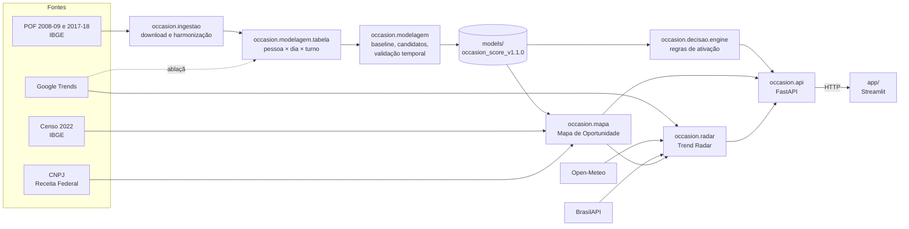

# Occasion Intelligence: Pizza + Guaraná

Sistema de dados que estima **quando e para quem** a ocasião pizza com refrigerante é mais
provável e transforma essa estimativa em uma **recomendação de ativação** para o Guaraná
Antarctica. Projeto do case Inteli x Ambev (TAPI).

- **Occasion Score:** probabilidade calibrada (0 a 100) de uma pessoa comer pizza com
  refrigerante em um turno, dado o momento, o lugar e o público. Treinado nos microdados da
  POF/IBGE.
- **Decision Engine:** regras explícitas e documentadas que escolhem uma categoria de ativação
  a partir do score, do contexto e dos fatores, com justificativa.
- **API (FastAPI) e app (Streamlit):** simulador de contexto, Mapa de Oportunidade, Trend
  Radar e página do modelo. O app chama a API por HTTP.
- **Extras entregues:** Mapa de Oportunidade com 319 municípios priorizados e Trend Radar com
  alerta semanal por UF.

> Vídeo de demonstração: _link a incluir_.

## Sumário

1. [Como rodar](#como-rodar)
2. [Arquitetura](#arquitetura)
3. [Dados](#dados)
4. [Metodologia](#metodologia)
5. [Resultados](#resultados)
6. [Decision Engine](#decision-engine)
7. [Mapa de Oportunidade](#mapa-de-oportunidade)
8. [Trend Radar](#trend-radar)
9. [Limitações](#limitações)
10. [Estrutura do repositório](#estrutura-do-repositório)
11. [English summary](#english-summary)

## Como rodar

Pré-requisitos: [uv](https://docs.astral.sh/uv/) (instala o Python 3.14 fixado em
`.python-version`) e cerca de 3 GB livres se for refazer o pipeline.

### App e API (não precisa baixar dados)

O modelo treinado (`models/`) e os pontos do Mapa de Oportunidade (`data/referencia/`) estão
versionados, então a demonstração roda direto de um clone:

```bash
uv sync
./app/rodar.sh
```

O script sobe a API em http://localhost:8000 (documentação interativa em `/docs`) e o app em
http://localhost:8501. Para subir separado:

```bash
uv run uvicorn occasion.api.app:app --port 8000
OCCASION_API_URL=http://localhost:8000 uv run streamlit run app/streamlit_app.py
```

Exemplo de chamada:

```bash
curl -X POST http://localhost:8000/predict -H "Content-Type: application/json" -d '{
  "turno": "noite", "dia_semana": 6, "regiao": "Sudeste", "tipo_area": "capital",
  "faixa_idade": "25-29", "sexo": "mulher", "renda_sm": 5, "canal": "delivery"
}'
```

A resposta segue o contrato do case: `occasion_score`, `classification`, `top_factors`,
`recommendation_category`, `recommendation_reason` e `model_metadata`, mais o canal, as
mensagens, a regra aplicada e o melhor momento da semana para o mesmo perfil.

### Pipeline completo (reproduz os números)

```bash
uv run python -m occasion.ingestao.download       # microdados da POF no FTP do IBGE (~2,3 GB)
uv run python -m occasion.ingestao.pof            # consumo harmonizado das duas edições
uv run python -m occasion.modelagem.tabela        # tabela de modelagem
uv run python -m occasion.modelagem.experimentos  # baseline, logística, LightGBM e ablação
uv run --group automl python -m occasion.modelagem.candidatos  # candidatos e AutoML
uv run python -m occasion.modelagem.final         # modelo do app (models/)
uv run python -m occasion.modelagem.incerteza     # 200 réplicas do bootstrap para o IC95 (~10 min)
uv run python -m occasion.modelagem.avaliacao     # importância, faixas, segmentos e erros
uv run --group sintetico --group eda python -m occasion.modelagem.sintetico  # teste de dados sintéticos (~40 min)
```

Os relatórios gerados ficam em `data/processed/`; as cópias usadas nesta entrega estão em
[`docs/relatorios/`](docs/relatorios/). O Mapa de Oportunidade tem o próprio pipeline (Censo
2022, CNPJ e OSM; veja a docstring de `occasion.mapa.oportunidade`). O Trend Radar lê as
coletas versionadas em `data/referencia/radar_*` e roda sem baixar nada:

```bash
uv run python -m occasion.radar.radar     # alertas (data/referencia/radar_alertas.json) e relatório
# refazer as coletas (opcional): occasion.radar.trends, occasion.radar.clima, occasion.radar.feriados
```

EDA:

```bash
uv run --group eda jupytext --to ipynb --set-kernel python3 --execute notebooks/eda_occasion_score.py
```

### Testes

```bash
uv run pytest -m "not dados"   # roda no CI, sem os microdados
uv run pytest                  # inclui os testes com os microdados reais
uv run ruff check && uv run ruff format --check
```

## Arquitetura

Coleta, dados, modelo, regras e interface ficam em camadas separadas. O app não importa o
modelo: toda previsão passa pela API.



| camada | tecnologia | por quê |
|---|---|---|
| Ingestão | Python, urllib, leitura do layout SAS do IBGE | os microdados vêm em largura fixa com programas de leitura SAS |
| Dados | pandas, Parquet | volume cabe em memória (1,2 milhão de linhas de consumo em 2017-18) |
| Modelo | scikit-learn (logística com splines, Platt), LightGBM, FLAML | candidatos de capacidade crescente; a escolha é por experimento |
| Explicação | SHAP linear exato da logística | a contribuição de cada feature é fechada e soma ao logit do score |
| Serviço | FastAPI + Pydantic | contrato de entrada e saída validado |
| Interface | Streamlit + pydeck + Altair | demonstração com mapa |
| Reprodutibilidade | uv (lock), pytest, ruff, GitHub Actions | ambiente fixado e testes no CI |

## Dados

Detalhes no [Data Card](docs/data_card.md).

- **Unidade de análise:** pessoa × dia de registro × turno (manhã, almoço, tarde, noite).
- **Target:** pizza e refrigerante (genérico ou marca) com até 1 hora de diferença no turno.
  É consumo real declarado no diário alimentar da POF, não um proxy.
- **Fonte:** POF 2008-09 (267.612 linhas, 668 ocasiões) e POF 2017-18 (340.072 linhas, 811
  ocasiões), Consumo Alimentar Pessoal, IBGE. É a única fonte pública nacional com o que cada
  pessoa comeu e bebeu, em que dia da semana e a que horas, com peso amostral.
- **Por que não só Guaraná:** o Guaraná aparece em 185 das 811 ocasiões de 2017-18, pouco
  para um modelo. O modelo estima a ocasião em que o Guaraná compete; a fatia de Guaraná dentro
  dela (21%, IC95 15% a 28%) entra no Decision Engine.
- **Instante de previsão:** antes do turno, só com perfil, lugar e calendário. Local, tipo de
  refeição, dia atípico e itens consumidos ficam fora do modelo.
- **Google Trends** é proxy de interesse: testado como feature (empatou com a região) e mantido
  fora do modelo; nunca é target.

## Metodologia

A análise exploratória e as decisões de feature engineering estão em
[`notebooks/eda_occasion_score.ipynb`](notebooks/eda_occasion_score.ipynb).

1. **Baseline (sem ML):** taxa histórica ponderada por dia da semana × turno, o "sexta à noite
   é bom para pizza" do brief.
2. **Candidatos:** regressão logística (one-hot e splines na renda), logística com interação
   turno × dia, LightGBM regularizado, Random Forest e AutoML (FLAML).
3. **Validação temporal:** treino na POF 2008-09, teste na POF 2017-18. Hiperparâmetros por
   validação cruzada agrupada por setor censitário dentro de 2008-09. A escolha entre
   candidatos usa metade dos setores de 2017-18; a outra metade só mede. Regra: maior PR-AUC
   na seleção, mas se a diferença para um candidato mais simples tem IC95 com zero, fica o mais
   simples.
4. **Métrica principal: PR-AUC.** A ocasião ocorre em 0,33% dos turnos; com tantos negativos o
   ROC-AUC fica alto mesmo para modelos fracos. O custo de um falso positivo é uma ativação
   pouco relevante, e o de um falso negativo é uma ocasião que passa; a PR-AUC mede o
   equilíbrio entre os dois no ranking. Também reportamos ROC-AUC, lift e recall nos 10%
   maiores scores, precisão, recall e F1 no limiar, matriz de confusão e calibração.
5. **Ablação:** `tem_crianca`, `n_moradores`, Trends × região, dia agrupado. Saíram as que não
   mudaram a PR-AUC (IC95 por bootstrap pareado de setores cruzando zero).
6. **Modelo do app:** a logística escolhida, reajustada nas duas edições e calibrada por Platt
   em previsões fora da amostra de 2017-18. Features finais: turno, dia da semana, região,
   tipo de área, faixa de idade, sexo e percentil de renda.
7. **Explicação:** SHAP linear (exato para a logística), em logit calibrado, por previsão; e
   permutation importance na validação temporal.

## Resultados

Validação temporal (treino 2008-09, teste 2017-18, pesos da POF com cada dia da semana valendo
1/7). Reproduzido por `occasion.modelagem.final.metricas_temporais`.

| métrica | baseline (dia × turno) | logística final |
|---|---|---|
| PR-AUC | 0,0182 | **0,0288** |
| ROC-AUC | 0,880 | **0,899** |
| Lift nos 10% maiores | 5,8× | **6,9×** |
| Recall nos 10% maiores | 58% | **69%** |

- Ganho de PR-AUC sobre o baseline: +0,011 (IC95 +0,005 a +0,019).
- Na metade de avaliação, o LightGBM empatou com a logística (0,027 contra 0,027; diferença
  −0,001, IC95 −0,005 a +0,005), a Random Forest ficou abaixo (0,021) e o AutoML (0,023) não
  superou o baseline de forma significativa (IC95 −0,001 a +0,018). Pela regra de
  simplicidade, fica a logística.
- Calibração: média prevista 0,327% contra 0,327% observada; Brier 0,00321.
- Importância (queda da PR-AUC ao embaralhar): turno 80%, dia da semana 29%, renda 19%, faixa de
  idade 13%, região 5%.
- Faixas do score: **alta** (10% maiores da população) concentra 69% das ocasiões; **média**
  (10% a 30%), 24%; **baixa** (70% da população), 7%.
- Segmentos: o modelo ganha do baseline em todos os dias da semana e regiões. Na validação
  temporal, subestima o Nordeste (previsto/observado 0,63) e superestima o Centro-Oeste (1,48)
  e a classe A (1,92).
- Correção por grupo (modelo v1.1.0): no modelo final, medido fora da amostra em 2017-18, o
  score errava o nível do Nordeste (previsto/observado 0,68, IC95 0,54 a 0,85), do Centro-Oeste
  (1,42) e da área rural (1,63). O score servido (API, simulador e mapa) soma um offset no logit
  desses grupos; medida em metades de setores que a correção não viu, a razão vai para 0,99,
  1,01 e 1,04 (melhora nas 20 divisões de setores testadas), o recall nos 10% maiores sobe de
  70,1% para 71,7% e a PR-AUC empata (0,0312 contra 0,0313). A classe D não é corrigida porque está calibrada
  (0,95, IC95 0,71 a 1,35): ela concentra ocasiões perdidas pela régua nacional porque a
  ocasião é menos frequente nela, então a API mostra também a posição do score dentro da
  classe. Relatório: [viés por grupo](docs/relatorios/vies_por_grupo.md).

Relatórios completos: [experimentos](docs/relatorios/experimentos_occasion_score.md),
[candidatos](docs/relatorios/candidatos_occasion_score.md),
[avaliação, segmentos e erros](docs/relatorios/avaliacao_occasion_score.md).

**Dados sintéticos (teste controlado).** Testamos se somar linhas sintéticas ao treino de
2008-09 melhora o modelo em 2017-18. Comparamos VAE tabular condicional e mistura ponderada com
duplicação de positivos, SMOTE-NC, marginais independentes e rótulo aleatório, em 5 sementes,
com escolha numa metade dos setores e medida na outra. Nenhum braço passou na regra fixada
antes. Os melhores ficaram a até +0,0012 de PR-AUC do modelo só com dado real (0,0274), sem
IC95 acima de zero, e o VAE não superou nem o rótulo aleatório. O SMOTE-NC liderou na metade de
seleção (0,0349 contra 0,0316) e caiu na de avaliação (0,0239), o caso clássico de mais dado
que não é dado melhor. Quase todo braço com positivos extras piorou o recall no top 10% do
Nordeste e da classe D. O modelo servido não mudou. Relatório:
[dados sintéticos](docs/relatorios/dados_sinteticos.md).

## Decision Engine

Recebe o score, o contexto e os fatores e aplica sete regras em ordem (a primeira que vale
decide). Não é uma segunda previsão: sem histórico de ações e resultados, a recomendação é uma
decisão estruturada, e o sistema não afirma que uma ação vende mais que outra.

A categoria depende do score, do canal e da associação do Guaraná à pizza no segmento, como
pede a seção 7 do case. Antes (até 27/11), ela dependia quase só da faixa: no sábado à noite,
os 90 contextos do protótipo recebiam o mesmo combo. As interações no modelo foram testadas
(LightGBM, Random Forest, AutoML, turno × dia) e não ganharam da logística fora do tempo, então a
variação por contexto mora no Engine.

| regra | condição | categoria | por quê |
|---|---|---|---|
| 1 | faixa baixa fora da noite | sem ativação | 93% das ocasiões são à noite |
| 2 | faixa alta e baixa presença da marca no segmento (Sul, classe B) | awareness e construção de associação com criadores | o Guaraná já é fraco no refrigerante em geral ali |
| 3 | faixa alta e lacuna de associação no segmento (Norte, Nordeste, capitais) | conversão: levar o Guaraná para a pizza, no canal informado | o Guaraná é forte no refrigerante do dia a dia e some na pizza |
| 4 | faixa alta, sem sinal de associação | delivery → ativação via delivery; pizzaria → ação na pizzaria; em casa ou sem canal → combo para casa | 66% das ocasiões são em casa (delivery incluído) |
| 5 | o mesmo perfil chega à faixa alta no seu melhor dia e turno | criar frequência: criadores online, depois pizzaria do bairro | há afinidade no perfil; que a ação crie consumo novo é hipótese |
| 6 | faixa média e (baixa presença, lacuna ou classe B a D) | awareness e associação com criadores do segmento | B a D somam 86% das ocasiões; a classe A, 5% |
| 7 | resto | sem ativação (monitorar) | |

**Associação por segmento** ([`decisao/associacao.py`](src/occasion/decisao/associacao.py),
gravada em [`data/referencia/associacao_guarana.json`](data/referencia/associacao_guarana.json)):
fatia do Guaraná nas ocasiões de refrigerante em geral e nas de pizza com refrigerante, público de
20 a 44 anos da POF 2017-18, com IC95 por bootstrap de setores (1.000 réplicas).

| segmento | Guaraná no refrigerante em geral | Guaraná na pizza | lacuna (pontos, IC95) | ocasiões de pizza | leitura |
|---|---|---|---|---|---|
| Norte | 33,7% | 7,9% | +25,9 (12,3 a 38,6) | 63 | lacuna |
| Nordeste | 30,4% | 16,6% | +13,9 (5,7 a 20,7) | 147 | lacuna |
| capital | 20,9% | 11,9% | +9,0 (1,6 a 15,3) | 163 | lacuna |
| Sul | 17,5% (13,8 a 22,0) | 21,4% | −3,9 (−18,8 a 7,7) | 81 | baixa presença |
| classe B | 14,3% (10,2 a 19,9) | 21,5% | −7,2 (−24,5 a 7,1) | 65 | baixa presença |
| Brasil | 25,3% (22,9 a 27,8) | 21,1% | +4,2 (−3,3 a 11,2) | 444 | |

Critérios fixos no código: lacuna = IC95 acima de zero e pelo menos 60 ocasiões de pizza; baixa
presença = IC95 do segmento inteiro abaixo do IC95 nacional. Rural (33 ocasiões) e classe E (44)
ficam de fora pela amostra; a faixa de 30 a 34 anos passa no limite e fica de fora (17
comparações). Quando há baixa presença e lacuna juntas, vale a baixa presença. A associação é
inferida pela fatia do Guaraná, não medida por pesquisa de marca. Para refazer:
`uv run python -m occasion.decisao.associacao`.

**Plano de ativação** (`activation_plan`, [`decisao/plano.py`](src/occasion/decisao/plano.py)).
Toda recomendação com ativação sai com um plano. O plano não muda a regra; ele detalha a decisão
só com dado medido:

| Campo | De onde vem |
|---|---|
| Para quem | perfil do contexto, segmento que disparou a regra, percentil na classe |
| Onde | 3 cidades de maior prioridade do Mapa de Oportunidade na região (capitais se a área é capital; o mapa não separa região metropolitana de interior; área rural fica sem lista) |
| Quando | dia e turno do contexto; à noite, 19h a 21h (70,9% das ocasiões começam aí, IC95 61,9 a 79,4, POF); na regra 5, a melhor noite de segunda a quinta do perfil; próximas 4 semanas da UF com feriados (Trend Radar, informativo) |
| Canal | o canal informado; sem canal, "em casa" só onde o IC95 da fatia em casa na região fica acima de 50% (Sudeste e Sul), senão casa e salão |
| Mecânica e mensagem | uma por categoria, marcadas como hipótese (sem dado de efeito) |
| Medição | indicador e linha de base do segmento na POF; sem meta, porque não há dado de efeito |

A saída traz também `class_position`: a posição do score entre as pessoas da mesma classe de
renda (2017-18). Não muda a regra; serve para mirar a expansão B a D sem inflar o score.

Código: [`src/occasion/decisao/engine.py`](src/occasion/decisao/engine.py).

## Incerteza, fontes e limites

Cada resposta do `/predict` diz o quanto confiar no score, sem mudar a regra (a regra continua
decidida pelo score pontual):

- **`uncertainty.occasion_score_ic95`:** intervalo de 95% por bootstrap de setores censitários
  (o cluster da amostra da POF), 200 réplicas. Cada réplica refaz o pipeline inteiro do modelo
  servido: logística, Platt fora da amostra e offsets da correção por grupo (com os grupos fixos).
  Sem reamostragem, a réplica reproduz o modelo servido (diferença de 6×10⁻⁷ no logit). O
  melhor momento também traz o intervalo. Em 2017-18, a meia largura média do intervalo é 48%
  do score na faixa alta, 62% na média e 97% na baixa.
- **`uncertainty.faixa_estavel` e `prob_faixa`:** quando o IC95 cruza um corte de faixa, a
  incerteza pode mudar a faixa e, com ela, a recomendação, e a resposta avisa "faixa incerta".
  A regra não cria limite novo: usa os cortes de 10% e 30% e o nível de 95%. Em 2017-18 (amostra
  aleatória ponderada de 5%), o aviso aparece em 46% dos casos da faixa alta, 54% da média e 49%
  das noites. É o tamanho real da incerteza com 811 ocasiões. `prob_faixa` traz a fração das
  réplicas em cada faixa.
- **`uncertainty.poucos_dados` e `avisos`:** valor de entrada com menos de 30 ocasiões reais nas
  duas edições. Com 30 eventos, o erro relativo de uma taxa fica perto de 1/√30 = 18% (IC95
  ±36%); hoje nenhum valor fica abaixo (o menor é a manhã, com 35). A contagem do perfil
  completo (região × área × idade × sexo × classe) vem só como informação: nenhum perfil chega a
  20 ocasiões, porque o modelo soma o efeito de cada variável em vez de depender da combinação
  exata.
- **`sources`:** fonte, ano e link de cada número da justificativa.
- **`limitations`:** o que o modelo não sabe (dado de 2017-18, sem data nem clima, sem preço,
  sem separar delivery, alvo com qualquer refrigerante, associação e não causa).

O intervalo mede só a variação da amostra da POF. Ele não cobre a mudança de hábito desde
2017-18 nem erro de especificação do modelo. Código:
[`src/occasion/modelagem/incerteza.py`](src/occasion/modelagem/incerteza.py) e
[`src/occasion/decisao/fontes.py`](src/occasion/decisao/fontes.py); réplicas em
`models/occasion_score_v1.1.0_incerteza.npz`.

## Mapa de Oportunidade

Extra do case. Aplica o modelo, sem retreinar, ao público de 20 a 44 anos dos 319 municípios
com 100 mil habitantes ou mais (Censo 2022) e cruza com a oferta de pizzarias ativas no CNPJ
(17.271 pizzarias ativas nesses municípios, de 25.474 no país). Quatro regras: potencial alto e oferta alta → pizzaria do bairro (64
municípios); potencial alto e oferta baixa → delivery e criadores (28); potencial médio com
maioria B a D → awareness (164); o resto → monitorar (63). Relatório:
[`docs/relatorios/mapa_oportunidade.md`](docs/relatorios/mapa_oportunidade.md).

## Trend Radar

Extra do case. Diz se o interesse por pizza está subindo ou caindo em cada UF e o que explica
o movimento. Buscas medem interesse, não consumo: o Radar não entra no Occasion Score.

- **Unidade:** UF × semana. Sinal: Google Trends, "pizza", categoria Comida e bebida, 5 anos
  (sem a categoria, "fantasia de pizza" no Carnaval de 2025 quadruplicava a série). AC, AP e
  RR ficam fora por volume insuficiente (zero em mais de 20% das semanas).
- **Tendência:** últimas 4 semanas contra as mesmas semanas do ano anterior, com faixa de ruído
  da própria UF. Em 15/11/2026: SP, SC, MS e AL caindo além da faixa; nenhuma UF subindo.
- **Fatores:** regressão em painel do desvio semanal contra calendário (feriados nacionais da
  BrasilAPI, Carnaval, Natal e Ano-Novo, Dia da Pizza, início do mês) e clima da capital
  (Open-Meteo). Carnaval (+24 pontos %, IC95 21 a 27), Natal e Ano-Novo (+18, IC95 13 a 27)
  e semana com feriado (+7, IC95 4 a 9) se associam a mais buscas; o Dia da Pizza (+10, IC95
  −1 a 16) e o clima (temperatura −0,2 ponto por °C acima do normal, IC95 −0,9 a 0,6) não se
  distinguem de zero.
- **Validação fora do tempo** (treino até 2024, teste 2025-2026): o modelo não melhora de forma
  significativa o baseline "igual à média do último ano" (ganho de 0,5 ponto no erro médio, IC95
  −0,3 a 1,3). O Radar vale como detector de tendência com faixa de ruído e como calendário de
  janelas, não como previsão semanal.
- **Alerta:** regra documentada que cruza a tendência com o Mapa de Oportunidade (oportunidade,
  observar, atenção, estável). Relatório:
  [`docs/relatorios/trend_radar.md`](docs/relatorios/trend_radar.md).

## Limitações

- O dado mais recente é a POF 2017-18 (antes da pandemia e da expansão do delivery). A checagem
  com Google Trends e divulgações do iFood de 2024 a 2026 confirmou o padrão de noite e fim de
  semana, mas o nível da taxa pode ter mudado. A POF 2024-25 ainda não tem microdados.
- A POF não separa delivery nem registra data; canal, clima e feriados não entram no modelo.
- 811 ocasiões em 2017-18: segmentos finos (classe A, sábado) têm intervalos largos. A correção
  por grupo foi escolhida nos dados inteiros; rodada em só metade dos setores, a regra de
  significância escolhe grupos diferentes, então os offsets são uma melhora medida, não exata.
- O modelo é aditivo: o melhor dia e turno é o mesmo (sábado à noite) para todo perfil.
- Mensagens e a regra 5 trazem hipóteses marcadas como tais; nenhuma recomendação afirma
  efeito causal.

## Estrutura do repositório

```
app/                    app Streamlit (cliente da API) e rodar.sh
data/referencia/        dados públicos pequenos versionados (estratos, Trends, OSM, mapa)
docs/                   Data Card e relatórios dos experimentos
models/                 modelo final versionado (joblib + metadados)
notebooks/              EDA (fonte .py e notebook executado)
src/occasion/ingestao/  download e leitura dos microdados da POF
src/occasion/modelagem/ tabela, treino, candidatos, modelo final e avaliação
src/occasion/decisao/   Decision Engine
src/occasion/mapa/      Mapa de Oportunidade
src/occasion/radar/     Trend Radar (Trends, clima, feriados, alertas)
src/occasion/api/       API FastAPI
tests/                  pytest (os marcados com `dados` usam os microdados)
```

## English summary

Occasion Intelligence for Pizza + Guaraná Antarctica (Inteli x Ambev case). An Occasion Score
(calibrated probability that a person eats pizza with a soft drink in a given part of the day)
is trained on IBGE's Household Budget Survey (POF) food diaries, with temporal validation
(train 2008-09, test 2017-18). A logistic regression beats the day × time-of-day baseline on
PR-AUC (0.0288 vs 0.0182; top-10% recall 69% vs 58%) and was kept over LightGBM, Random Forest
and AutoML by a simplicity rule. A rule-based Decision Engine turns score, context and SHAP
factors into an activation category with its reason. A FastAPI service exposes the contract
(`/predict`, `/model`, `/mapa`, `/radar`); every prediction carries a 95% interval from a
census-tract bootstrap of the whole pipeline, band stability, a low-data warning, the source and
year of each number, and what the model does not know, and a Streamlit app consumes it over HTTP. The
optional Opportunity Map ranks 319 Brazilian cities by expected occasions and pizzeria supply.
The optional Trend Radar tracks weekly Google Trends interest in pizza per state against the
same weeks last year, relates it to holidays (BrasilAPI) and capital-city weather
(Open-Meteo), and issues a rule-based alert; out of time it does not beat a last-year-mean
baseline, so it is used as a trend detector with a noise band, not as a weekly forecast. Run with
`uv sync && ./app/rodar.sh`. See the [Data Card](docs/data_card.md) for sources, leakage
strategy, biases and licensing.
