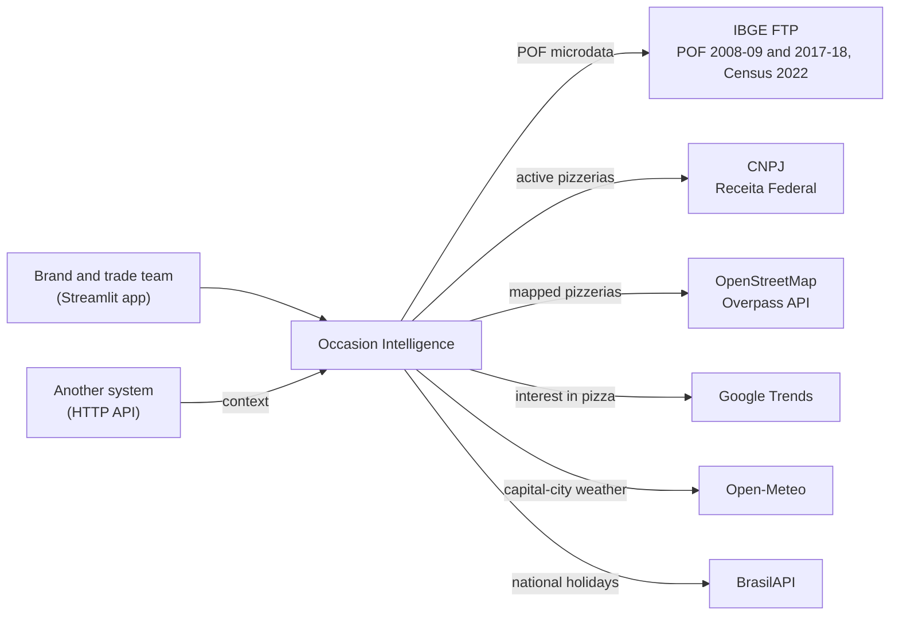
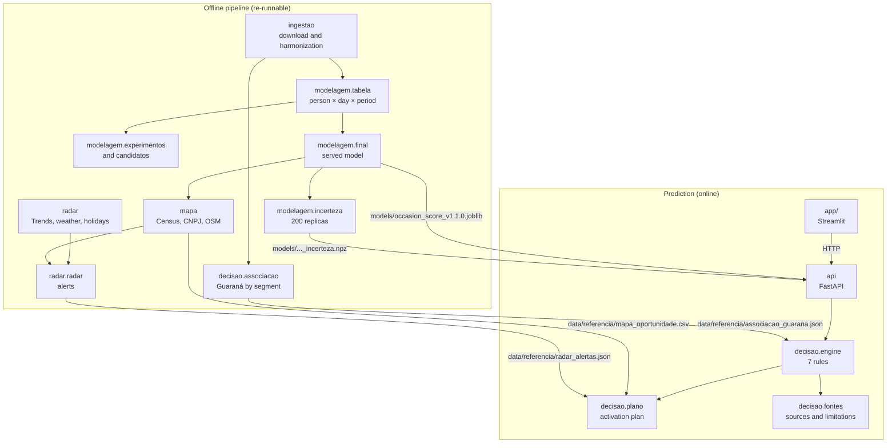
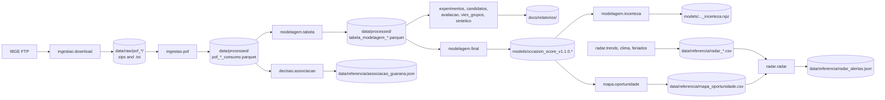

# Architecture

[Português](architecture.md) · English

How the system is organized, why it is built this way, and where each part lives. For the model in detail, see [`model.en.md`](model.en.md); for the data, the [Data Card](data_card.md) (Portuguese).

## Overview

The problem: tell **when, where and for whom** the pizza-with-soda occasion is most likely, and turn that into an **activation recommendation** for Guaraná Antarctica, with the reason and the source of every number.

The solution has two halves:

- **Offline**: downloads the POF microdata from IBGE's FTP, harmonizes the 2008-09 and 2017-18 editions, builds the person × day × meal-period table, compares candidates with temporal validation, trains the served model and computes the supporting tables (Guaraná association by segment, interval replicas, Opportunity Map and Trend Radar). Everything the online part needs is versioned in `models/` and `data/referencia/`.
- **Online**: the API receives a context (day, meal period, region, area type, age, sex, income and, optionally, channel), computes the Occasion Score with an interval, applies the seven Decision Engine rules and returns the activation category, the reason, the activation plan, the sources and the limitations. The Streamlit app only talks to the API.

The Decision Engine is written rules, not a second model. With no history of actions and outcomes, nothing in the system claims that one activation sells more than another.

## Context

Who uses the system and which sources it depends on:

External sources are only used in the offline collections. At prediction time, the API reads only the files versioned in the repository and calls no service.

## Containers

| Container | Responsibility | Technology |
|---|---|---|
| Ingestion | Idempotent microdata download, reading IBGE's official SAS layout, harmonizing both editions | Python, urllib, pandas |
| Modeling table | One row per person × recorded day × meal period, with target, weights and features | pandas, Parquet |
| Experiments | Baseline, logistic, LightGBM, Random Forest, AutoML, ablation and the selection rule | scikit-learn, LightGBM, FLAML |
| Served model | Logistic with splines, Platt calibration and a per-group logit correction | scikit-learn, joblib |
| Uncertainty | Census-tract bootstrap of the whole served-model pipeline | NumPy |
| Association | Guaraná's share of soda in general and of pizza by segment, with 95% CI | pandas, NumPy |
| Opportunity Map | 20–44 audience of municipalities with 100k+ inhabitants, scored by the model and crossed with pizzeria supply | pandas, geopandas (`mapa` group) |
| Trend Radar | Weekly search trend by state, calendar and weather factors, alert | pandas, pytrends |
| API | Pydantic input and output contract, `/predict`, `/model`, `/mapa`, `/radar` | FastAPI, Pydantic |
| Decision Engine | Ordered rules, activation plan, sources and limitations | plain Python |
| App | Simulator, Map, Radar and model page, always over HTTP | Streamlit, pydeck, Altair, httpx |

## Offline pipeline

The commands for each step are in the [README](../README.en.md#installation-and-usage). Steps with random draws use a fixed seed, and external collections that change on every request (Google Trends) are versioned so the results reproduce.

## Code map

Package `occasion` (in `src/`):

- `paths`: data folders (the root can come from `OCCASION_DATA_DIR`).
- `ingestao` (ingestion):
  - `download`: POF microdata from IBGE's FTP, with a signature marker so files are not downloaded twice;
  - `layout`: column positions read from each edition's official SAS program;
  - `codigos`: food codes for pizza and soda, with the official registry description;
  - `pof`: harmonized individual food consumption for both editions;
  - `trends`: interest in pizza by state during each POF's fieldwork window (ablation).
- `modelagem` (modeling):
  - `tabela`: person × day × period table, target, weights (each weekday counts 1/7) and features;
  - `treino`: baseline, weighted metrics, paired tract bootstrap;
  - `experimentos`: logistic versus LightGBM and feature ablation;
  - `candidatos`: candidate comparison and AutoML, with the simplicity rule;
  - `final`: the served model, the explanation (linear SHAP) and the bands;
  - `correcao` and `vies_grupos`: the per-group level error and the logit offset;
  - `incerteza`: the bootstrap replicas and each prediction's 95% CI;
  - `avaliacao`: importance, bands, segments and errors;
  - `sintetico`: the controlled synthetic-data experiment.
- `decisao` (decision):
  - `engine`: the context, the seven rules, the reason text and the output contract;
  - `associacao`: the Guaraná-by-segment table and the gap and low-presence criteria;
  - `plano`: the activation plan (who, where, when, channel, mechanic, measurement);
  - `criadores`: the plan's content-creator profile, with sources;
  - `fontes`: the source and year of every number, and what the model does not know.
- `mapa`: `censo` (audience by municipality), `cnpj` and `osm` (pizzeria supply), `score` (the model applied to the audience) and `oportunidade` (rules and ranking).
- `radar`: `trends`, `clima` and `feriados` (collections), `radar` (trend, factors, validation and alert).
- `api.app`: the FastAPI API.

Outside the package:
- `app/`: the Streamlit app (`cliente.py` talks to the API; `paginas/` has one page per screen) and `rodar.sh`;
- `models/`: the served model and the interval replicas;
- `data/referencia/`: small public tables the API reads;
- `notebooks/`: exploratory analysis (`.py` source and executed notebook);
- `docs/`: this documentation, the Data Card and the experiment reports;
- `tests/`: pytest.

## Invariants

Rules the code upholds that are not visible from a single file:

- **The app does not import the model.** Every prediction goes through the API, as the case's architecture requires.
- **Nothing after the meal period enters the features.** Prediction happens before the period: only profile, place and calendar. Meal location, items consumed and meal type stay out of the model (see the [Data Card](data_card.md#estratégia-anti-leakage)).
- **Model selection never sees the final metric.** Candidates train on 2008-09. Selection uses half of the 2017-18 census tracts, and the other half only measures.
- **The rule uses the point score.** The interval, the uncertain-band warning and the within-class position inform but do not change the category.
- **The activation plan does not change the rule.** It only details the decision already made, with measured data. Whatever is a hypothesis (mechanic, message) is labeled as such.
- **Every number in the reason has a source.** `decisao.fontes` holds the source, year and link of every number cited. Market figures in the creator profiles come from secondary sources, and the response says so.
- **The association only applies to the measured audience.** The gap and low-presence signals come from people aged 20 to 44. Outside that range, the Engine does not use them.
- **A broken reference table does not break prediction.** The plan reloads the tables when the file changes, and an invalid creators file only drops the creator line.
- **The repository does not redistribute microdata.** `data/raw/` and `data/processed/` stay out of git. Tests that need them are marked `dados` and skipped in CI.

## Boundaries

| Boundary | Between | Format |
|---|---|---|
| HTTP | App (or another system) and API | JSON validated by Pydantic. Optional `versao_modelo` in the input: if it does not match the served version, the API returns 409 |
| Saved model | Offline pipeline and API | `models/occasion_score_v1.1.0.joblib` and `.json` (coefficients, Platt, offsets, band cut-offs, metadata) |
| Replicas | `modelagem.incerteza` and API | `models/occasion_score_v1.1.0_incerteza.npz`, accepted only if the version and number of terms match the model |
| Reference tables | Offline pipelines and Engine | CSV and JSON in `data/referencia/`, with the schema described in each module's docstring |
| External sources | Offline collections and public services | FTP and HTTP, with the result versioned when the source changes on every request |

## Cross-cutting concerns

- **Configuration**: `OCCASION_API_URL` (API address for the app), `OCCASION_DATA_DIR` (data folder outside the repository) and `PORTA_API` (port used by `rodar.sh`). There are no API keys or secrets.
- **Sample weights**: every metric, rate and share uses the POF weight, with each weekday counting 1/7.
- **Uncertainty**: census-tract bootstrap, the cluster of the POF sample, instead of independent rows.
- **Reproducibility**: Python 3.14 pinned in `.python-version`, dependencies locked in `uv.lock`, fixed seeds, versioned external collections.
- **Quality**: pytest (tests that need microdata are marked `dados`), ruff, and GitHub Actions CI with lint and tests.

## Architecture decisions

A short record of the decisions that shape the system (context, decision and consequence).

| Decision | Context | Consequence |
|---|---|---|
| POF as the only target source | The only national public dataset with what each person ate and drank, on which day and at what time, with sample weights. Ambev does not share data (LGPD) | The target is real declared consumption, not a proxy; the latest data is from 2017-18 |
| Target with any soda | Guaraná appears in 185 of the 811 occasions in 2017-18, too few for a model | The model estimates the occasion Guaraná competes for; Guaraná's share enters the Engine by segment |
| Temporal validation 2008-09 → 2017-18 | The question is whether the learned pattern holds in the future | The reported metric is out-of-time; the served model is refit on both editions |
| Logistic instead of LightGBM | Tie out of time, with the difference's 95% CI crossing zero | Exact explanation (linear SHAP) and an additive model: the best day and period is the same for every profile, and context variation lives in the Engine |
| Per-group logit correction | The score got the level wrong for the Northeast, Center-West and rural areas out of sample | Offsets only for groups where the correction improves calibration on tracts it did not see |
| Rule-based Engine, not a model | There is no history of actions and outcomes to learn an activation's effect | Auditable recommendation, with reason and source; no causal effect claimed |
| Guaraná association by segment | Section 7 of the case asks for variation by context, and the model does not distinguish the brand | Gap (North, Northeast, state capitals) and low presence (South, class B) decide between conversion and awareness |
| Interval by bootstrapping the whole pipeline | With 811 occasions, uncertainty is large and must be visible | 95% CI and an uncertain-band warning in every response, without changing the rule |
| Google Trends kept out of the score | It measures interest, not consumption, and tied with region in the ablation | The Trend Radar is a separate, informational product |
| App only over HTTP | Layered architecture required by the case | The app runs against any API instance; the API is testable on its own |
| Versioned reference tables | The demo must run from a clone without downloading 2.3 GB | `uv sync && ./app/rodar.sh` brings everything up; rebuilding the numbers requires the full pipeline |

## Where artifacts live

| Path | Content | In git |
|---|---|---|
| `data/raw/pof_2008_2009/`, `data/raw/pof_2017_2018/` | IBGE microdata, documentation and reading programs | no |
| `data/processed/` | Harmonized consumption, modeling table and generated reports | no |
| `models/occasion_score_v1.1.0.joblib`, `.json` | Served model and metadata | yes |
| `models/occasion_score_v1.1.0_incerteza.npz` | Bootstrap replicas for the 95% CI | yes |
| `models/occasion_score_v1.0.0.*` | Previous version, without the per-group correction | yes |
| `data/referencia/associacao_guarana.json` | Guaraná by segment, start time and at-home consumption | yes |
| `data/referencia/perfis_criadores.json` | Creator profiles with sources | yes |
| `data/referencia/mapa_oportunidade.csv`, `pizzarias_osm_br.csv`, `ufs_ibge_minima.geojson` | Opportunity Map | yes |
| `data/referencia/radar_*.csv`, `radar_alertas.json` | Trend Radar collections and alerts | yes |
| `data/referencia/estratos_pof.csv`, `trends_pizza_uf.csv` | Area type by stratum and the ablation's Trends | yes |
| `docs/relatorios/` | Copies of the reports used in this delivery | yes |
