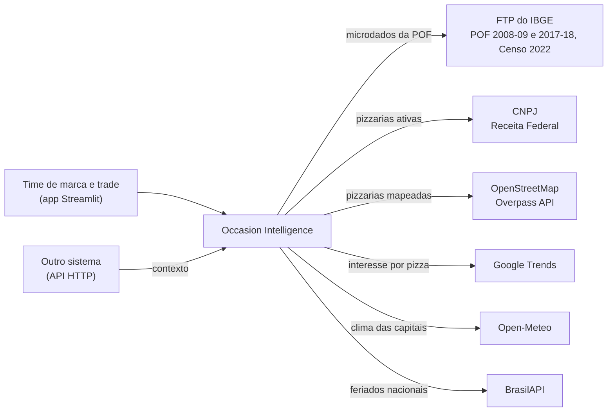
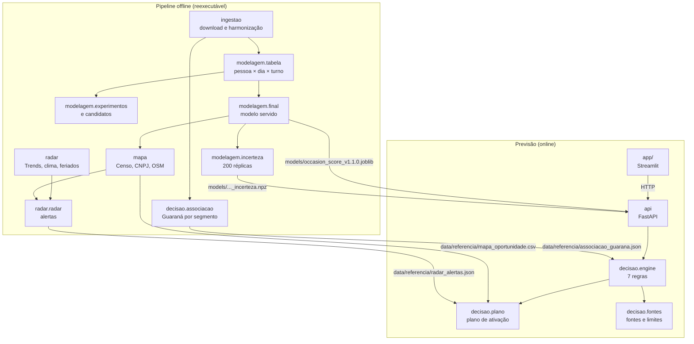
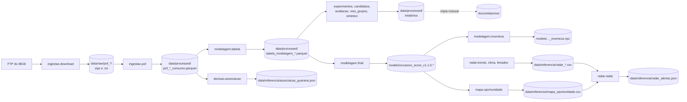

# Arquitetura

Português · [English](architecture.en.md)

Como o sistema está organizado, por que está assim e onde fica cada parte. Para o modelo em detalhe, ver [`model.md`](model.md); para a base, o [Data Card](data_card.md).

## Visão geral

O problema: dizer **quando, onde e para quem** a ocasião pizza com refrigerante é mais provável e transformar isso numa **recomendação de ativação** para o Guaraná Antarctica, com o motivo e a fonte de cada número.

A solução tem duas metades:

- **Offline**: baixa os microdados da POF no FTP do IBGE, harmoniza as edições 2008-09 e 2017-18, monta a tabela pessoa × dia × turno, compara candidatos com validação temporal, treina o modelo servido e calcula as tabelas de apoio (associação do Guaraná por segmento, réplicas do intervalo, Mapa de Oportunidade e Trend Radar). Tudo o que a parte online precisa fica versionado em `models/` e `data/referencia/`.
- **Online**: a API recebe um contexto (dia, turno, região, tipo de área, idade, sexo, renda e, se houver, o canal), calcula o Occasion Score com intervalo, aplica as sete regras do Decision Engine e devolve a categoria de ativação, o motivo, o plano de ativação, as fontes e os limites. O app Streamlit só conversa com a API.

O Decision Engine é regra escrita, não um segundo modelo. Sem histórico de ações e resultados, nada no sistema afirma que uma ativação vende mais que outra.

## Contexto

Quem usa o sistema e de que fontes ele depende:

As fontes externas só entram nas coletas offline. Na previsão, a API lê apenas os arquivos versionados no repositório e não chama serviço nenhum.

## Contêineres

| Contêiner | Responsabilidade | Tecnologia |
|---|---|---|
| Ingestão | Download idempotente dos microdados, leitura do layout SAS oficial, harmonização das duas edições | Python, urllib, pandas |
| Tabela de modelagem | Uma linha por pessoa × dia de registro × turno, com alvo, pesos e features | pandas, Parquet |
| Experimentos | Baseline, logística, LightGBM, Random Forest, AutoML, ablação e regra de escolha | scikit-learn, LightGBM, FLAML |
| Modelo servido | Logística com splines, calibração de Platt e correção por grupo no logit | scikit-learn, joblib |
| Incerteza | Bootstrap por setor censitário de todo o pipeline do modelo servido | NumPy |
| Associação | Fatia do Guaraná no refrigerante em geral e na pizza por segmento, com IC95 | pandas, NumPy |
| Mapa de Oportunidade | Público de 20 a 44 anos dos municípios com 100 mil habitantes ou mais, pontuado pelo modelo e cruzado com a oferta de pizzarias | pandas, geopandas (grupo `mapa`) |
| Trend Radar | Tendência semanal de buscas por UF, fatores de calendário e clima, alerta | pandas, pytrends |
| API | Contrato Pydantic de entrada e saída, `/predict`, `/model`, `/mapa`, `/radar` | FastAPI, Pydantic |
| Decision Engine | Regras em ordem, plano de ativação, fontes e limites | Python puro |
| App | Simulador, Mapa, Radar e página do modelo, sempre via HTTP | Streamlit, pydeck, Altair, httpx |

## Pipeline offline

Os comandos de cada etapa estão no [README](../README.md#instalação-e-execução). As etapas com sorteio usam semente fixa, e as coletas externas que mudam a cada pedido (Google Trends) ficam versionadas para que o resultado se reproduza.

## Mapa do código

Pacote `occasion` (em `src/`):

- `paths`: pastas de dados (a raiz pode vir de `OCCASION_DATA_DIR`).
- `ingestao`:
  - `download`: microdados da POF no FTP do IBGE, com marca de assinatura para não baixar de novo;
  - `layout`: posições das colunas lidas do programa SAS oficial de cada edição;
  - `codigos`: códigos de alimento de pizza e refrigerante, com a descrição do cadastro oficial;
  - `pof`: consumo alimentar pessoal harmonizado das duas edições;
  - `trends`: interesse por pizza por UF na janela de campo de cada POF (ablação).
- `modelagem`:
  - `tabela`: tabela pessoa × dia × turno, alvo, pesos (cada dia da semana vale 1/7) e features;
  - `treino`: baseline, métricas ponderadas, bootstrap pareado por setor;
  - `experimentos`: logística contra LightGBM e ablação de features;
  - `candidatos`: comparação de candidatos e AutoML, com a regra de simplicidade;
  - `final`: o modelo servido, a explicação (SHAP linear) e as faixas;
  - `correcao` e `vies_grupos`: o erro de nível por grupo e o offset no logit;
  - `incerteza`: as réplicas do bootstrap e o IC95 de cada previsão;
  - `avaliacao`: importância, faixas, segmentos e erros;
  - `sintetico`: o experimento controlado com dados sintéticos.
- `decisao`:
  - `engine`: o contexto, as sete regras, o texto do motivo e o contrato de saída;
  - `associacao`: a tabela do Guaraná por segmento e os critérios de lacuna e baixa presença;
  - `plano`: o plano de ativação (para quem, onde, quando, canal, mecânica, medição);
  - `criadores`: o perfil de criador de conteúdo do plano, com fonte;
  - `fontes`: a fonte e o ano de cada número, e o que o modelo não sabe.
- `mapa`: `censo` (público por município), `cnpj` e `osm` (oferta de pizzarias), `score` (o modelo aplicado ao público) e `oportunidade` (as regras e o ranking).
- `radar`: `trends`, `clima` e `feriados` (coletas), `radar` (tendência, fatores, validação e alerta).
- `api.app`: a API FastAPI.

Fora do pacote:
- `app/`: o app Streamlit (`cliente.py` fala com a API; `paginas/` tem uma página por tela) e `rodar.sh`;
- `models/`: o modelo servido e as réplicas do intervalo;
- `data/referencia/`: tabelas pequenas e públicas que a API lê;
- `notebooks/`: a análise exploratória (fonte `.py` e notebook executado);
- `docs/`: esta documentação, o Data Card e os relatórios dos experimentos;
- `tests/`: pytest.

## Invariantes

Regras que o código mantém e que não aparecem lendo um arquivo só:

- **O app não importa o modelo.** Toda previsão passa pela API, como pede a arquitetura do case.
- **Nada posterior ao turno entra nas features.** O instante de previsão é antes do turno: só perfil, lugar e calendário. Local da refeição, itens consumidos e tipo de refeição ficam fora do modelo (ver o [Data Card](data_card.md#estratégia-anti-leakage)).
- **A escolha do modelo nunca vê a métrica final.** Os candidatos treinam em 2008-09. A escolha usa metade dos setores de 2017-18, e a outra metade só mede.
- **A regra usa o score pontual.** O intervalo, o aviso de faixa incerta e a posição na classe informam, mas não mudam a categoria.
- **O plano de ativação não muda a regra.** Ele só detalha a decisão já tomada com dados medidos. O que é hipótese (mecânica, mensagem) vem marcado.
- **Todo número da justificativa tem fonte.** `decisao.fontes` guarda fonte, ano e link de cada número citado. Os números de mercado dos perfis de criador são de fontes secundárias, e a resposta diz isso.
- **A associação só vale para o público medido.** Os sinais de lacuna e baixa presença vêm de pessoas de 20 a 44 anos. Fora dessa faixa, o Engine não os usa.
- **Uma tabela de referência quebrada não derruba a previsão.** O plano relê as tabelas quando o arquivo muda, e um arquivo de criadores inválido só tira a linha do criador.
- **O repositório não redistribui microdados.** `data/raw/` e `data/processed/` ficam fora do git. Os testes que precisam deles são marcados com `dados` e pulados no CI.

## Fronteiras

| Fronteira | Entre | Formato |
|---|---|---|
| HTTP | App (ou outro sistema) e API | JSON validado por Pydantic. `versao_modelo` opcional na entrada: se não bater com a versão servida, a API responde 409 |
| Modelo salvo | Pipeline offline e API | `models/occasion_score_v1.1.0.joblib` (o modelo inteiro, com os coeficientes) e `.json` (metadados: Platt, offsets, cortes das faixas e validação) |
| Réplicas | `modelagem.incerteza` e API | `models/occasion_score_v1.1.0_incerteza.npz`, aceitas só se a versão e o número de termos baterem com o modelo |
| Tabelas de referência | Pipelines offline e Engine | CSV e JSON em `data/referencia/`, com o esquema descrito na docstring de cada módulo |
| Fontes externas | Coletas offline e serviços públicos | FTP e HTTP, com o resultado versionado quando a fonte muda a cada pedido |

## Preocupações transversais

- **Configuração**: `OCCASION_API_URL` (endereço da API para o app), `OCCASION_DATA_DIR` (pasta de dados fora do repositório), `OCCASION_MODEL_PATH` e `OCCASION_INCERTEZA_PATH` (modelo e réplicas fora de `models/`) e `PORTA_API` (porta do `rodar.sh`). Não há chave de API nem segredo.
- **Pesos amostrais**: toda métrica, taxa e fatia usa o peso da POF, com cada dia da semana valendo 1/7.
- **Incerteza**: bootstrap por setor censitário, o cluster da amostra da POF, em vez de linhas independentes.
- **Reprodutibilidade**: Python 3.14 fixado em `.python-version`, dependências travadas no `uv.lock`, sementes fixas, coletas externas versionadas.
- **Qualidade**: pytest (os testes com microdados são marcados com `dados`), ruff e CI no GitHub Actions com lint e testes.

## Decisões de arquitetura

Registro curto das decisões que moldam o sistema (contexto, decisão e consequência).

| Decisão | Contexto | Consequência |
|---|---|---|
| POF como única fonte do alvo | É a única base pública nacional com o que cada pessoa comeu e bebeu, em que dia e a que horas, com peso amostral. A Ambev não cede dados (LGPD) | O alvo é consumo real declarado, não um proxy; o dado mais recente é de 2017-18 |
| Alvo com qualquer refrigerante | O Guaraná aparece em 185 das 811 ocasiões de 2017-18, pouco para um modelo | O modelo estima a ocasião em que o Guaraná compete; a fatia do Guaraná entra no Engine, por segmento |
| Validação temporal 2008-09 → 2017-18 | A pergunta é se o padrão aprendido vale no futuro | A métrica reportada é fora do tempo; o modelo servido é reajustado nas duas edições |
| Logística em vez de LightGBM | Empate fora do tempo, com IC95 da diferença cruzando zero | Explicação exata (SHAP linear) e modelo aditivo: o melhor dia e turno é o mesmo para todo perfil, e a variação por contexto fica no Engine |
| Correção por grupo no logit | O score errava o nível do Nordeste, do Centro-Oeste e da área rural fora da amostra | Offsets só nos grupos em que a correção melhora a calibração em setores que ela não viu |
| Engine por regras, não por modelo | Não há histórico de ações e resultados para aprender o efeito de uma ativação | Recomendação auditável, com motivo e fonte; nenhum efeito causal afirmado |
| Associação do Guaraná por segmento | A seção 7 do case pede variação por contexto, e o modelo não distingue a marca | Lacuna (Norte, Nordeste, capitais) e baixa presença (Sul, classe B) decidem entre conversão e awareness |
| Intervalo por bootstrap de todo o pipeline | Com 811 ocasiões, a incerteza é grande e precisa aparecer | IC95 e aviso de faixa incerta em cada resposta, sem mudar a regra |
| Google Trends fora do score | Mede interesse, não consumo, e empatou com a região na ablação | O Trend Radar é um produto à parte, informativo |
| App só via HTTP | Arquitetura em camadas pedida no case | O app roda contra qualquer instância da API; a API é testável sozinha |
| Tabelas de referência versionadas | A demonstração precisa rodar de um clone, sem baixar 2,3 GB | `uv sync && ./app/rodar.sh` sobe tudo; refazer os números exige o pipeline completo |

## Onde ficam os artefatos

| Caminho | Conteúdo | No git |
|---|---|---|
| `data/raw/pof_2008_2009/`, `data/raw/pof_2017_2018/` | Microdados, documentação e programas de leitura do IBGE | não |
| `data/processed/` | Consumo harmonizado, tabela de modelagem e relatórios gerados | não |
| `models/occasion_score_v1.1.0.joblib`, `.json` | Modelo servido e metadados | sim |
| `models/occasion_score_v1.1.0_incerteza.npz` | Réplicas do bootstrap para o IC95 | sim |
| `models/occasion_score_v1.0.0.*` | Versão anterior, sem a correção por grupo | sim |
| `data/referencia/associacao_guarana.json` | Guaraná por segmento, horário de início e consumo em casa | sim |
| `data/referencia/perfis_criadores.json` | Perfis de criador com fontes | sim |
| `data/referencia/mapa_oportunidade.csv`, `pizzarias_osm_br.csv`, `ufs_ibge_minima.geojson` | Mapa de Oportunidade | sim |
| `data/referencia/radar_*.csv`, `radar_alertas.json` | Coletas e alertas do Trend Radar | sim |
| `data/referencia/estratos_pof.csv`, `trends_pizza_uf.csv` | Tipo de área por estrato e Trends da ablação | sim |
| `docs/relatorios/` | Cópias dos relatórios usados nesta entrega | sim |
