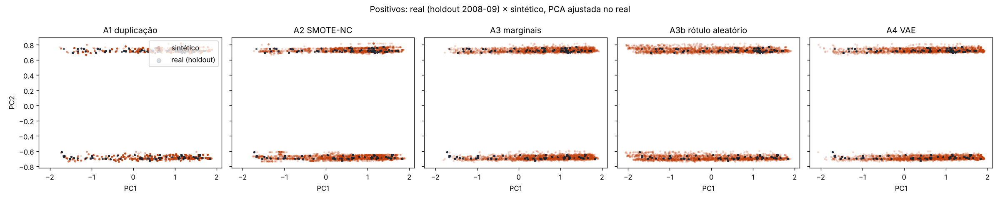

# Dados sintéticos: experimento controlado

Pergunta: somar linhas sintéticas ao treino melhora o Occasion Score fora do tempo, medido só em dado real da POF 2017-18, sem distorcer a probabilidade? O modelo servido não muda com este experimento.

**Resultado.** Nenhum braço sintético passou na regra de decisão. Controles ruins piores que A0 (PR-AUC com IC95 abaixo de zero ou log loss com IC95 acima de zero): A3 marginais · TSTR (só sintético) pior, A3 marginais · completo não pior, A3 marginais · positivos não pior, A3b rótulo aleatório · positivos não pior. Pelo menos um controle ruim foi detectado, então as métricas conseguem separar dado bom de ruim.

## Dados

- Treino real: POF 2008-09, 267.612 linhas, 668 positivos.
- Geradores aprendem em 3.462 setores de 2008-09 (535 positivos); holdout de fidelidade: 866 setores (133 positivos).
- Teste: POF 2017-18, 340.072 linhas, 811 positivos, em duas metades fixas de setores (seleção e avaliação).
- Sementes por gerador: 5. Bootstrap pareado de setores: 1000 réplicas.
- VAE: parâmetros padrão; perda final por semente: 9.022, 8.876, 8.680, 8.800, 8.726.

## Fidelidade (sintético × holdout real de 2008-09)

Cada linha compara 5.000 linhas com o holdout real da mesma classe (reamostras por `peso_final`). A linha de referência compara o real dos setores de treino com o holdout: é o quanto o próprio real varia entre setores, o piso esperado. Fréchet = distância de Fréchet entre gaussianas nos 10 primeiros componentes da PCA ajustada no real. TV = variação total (0 a 1). Cópias = linhas iguais a uma linha do treino (categóricas + renda arredondada a 1 ponto). Fora do suporte = combinação das 6 categóricas que não existe no real dos setores do gerador.

| braço | classe | frechet_pca | tv_media | tv_max | w1_renda | tv_dia_x_turno | tv_regiao_x_idade | copias_pct | fora_do_suporte_pct |
|---|---|---|---|---|---|---|---|---|---|
| referência: real (outros setores) | positivos | 0.239 | 0.119 | 0.281 | 5.399 | 0.238 | 0.372 | 28.900 | 0.000 |
| referência: real (outros setores) | negativos | 0.009 | 0.025 | 0.043 | 1.844 | 0.053 | 0.066 | 37.760 | 0.100 |
| A1 duplicação | positivos | 0.232 | 0.118 | 0.267 | 5.545 | 0.239 | 0.378 | 100 | 0.000 |
| A1 duplicação | negativos | 0.008 | 0.025 | 0.037 | 1.695 | 0.040 | 0.072 | 100 | 0.000 |
| A2 SMOTE-NC | positivos | 0.192 | 0.085 | 0.149 | 4.177 | 0.234 | 0.320 | 46.740 | 0.000 |
| A3 marginais | positivos | 0.197 | 0.118 | 0.274 | 5.018 | 0.199 | 0.390 | 23.380 | 1.960 |
| A3 marginais | negativos | 0.031 | 0.027 | 0.040 | 1.490 | 0.055 | 0.074 | 31.260 | 1.220 |
| A3b rótulo aleatório | positivos | 1.216 | 0.226 | 0.625 | 15.100 | 0.625 | 0.388 | 100 | 0.000 |
| A3b rótulo aleatório | negativos | 0.012 | 0.027 | 0.042 | 2.047 | 0.049 | 0.061 | 100 | 0.000 |
| A4 VAE | positivos | 0.195 | 0.121 | 0.269 | 5.324 | 0.193 | 0.388 | 23.460 | 1.940 |
| A4 VAE | negativos | 0.017 | 0.028 | 0.049 | 3.163 | 0.036 | 0.079 | 30.740 | 1.340 |

Notas do desenho: o SMOTE-NC usa os positivos reais únicos e ignora `peso_final` (numa reamostra com reposição os vizinhos seriam cópias da própria linha). O controle A3b (rótulo aleatório) foi acrescentado depois do teste curto do código, porque a logística é aditiva e A3 (marginais certas por classe) quase não a prejudica.

## Escolha na metade de seleção

PR-AUC de A0 na seleção: 0.0316. Configuração escolhida por braço (maior PR-AUC média das sementes):

| braço | volume (× positivos reais) | lam |
|---|---|---|
| A1 duplicação · positivos | 1 | 0.50 |
| A2 SMOTE-NC · positivos | 10 | 0.50 |
| A3 marginais · TSTR (só sintético) | 1 | 1 |
| A3 marginais · completo | 1 | 0.25 |
| A3 marginais · positivos | 1 | 0.10 |
| A3b rótulo aleatório · positivos | 1 | 0.25 |
| A4 VAE · TSTR (só sintético) | 1 | 1 |
| A4 VAE · completo | 1 | 1 |
| A4 VAE · positivos | 1 | 0.50 |

Grade completa (média e desvio entre sementes):

| braço | modo | volume | lam | mean | std |
|---|---|---|---|---|---|
| A1 duplicação | positivos | 1 | 0.1000 | 0.0328 | 0.0001 |
| A1 duplicação | positivos | 1 | 0.2500 | 0.0322 | 0.0008 |
| A1 duplicação | positivos | 1 | 0.5000 | 0.0329 | 0.0001 |
| A1 duplicação | positivos | 1 | 1 | 0.0314 | 0.0009 |
| A1 duplicação | positivos | 3 | 0.1000 | 0.0319 | 0.0008 |
| A1 duplicação | positivos | 3 | 0.2500 | 0.0315 | 0.0002 |
| A1 duplicação | positivos | 3 | 0.5000 | 0.0320 | 0.0002 |
| A1 duplicação | positivos | 3 | 1 | 0.0312 | 0.0003 |
| A1 duplicação | positivos | 10 | 0.1000 | 0.0312 | 0.0005 |
| A1 duplicação | positivos | 10 | 0.2500 | 0.0311 | 0.0001 |
| A1 duplicação | positivos | 10 | 0.5000 | 0.0305 | 0.0002 |
| A1 duplicação | positivos | 10 | 1 | 0.0303 | 0.0002 |
| A2 SMOTE-NC | positivos | 1 | 0.1000 | 0.0331 | 0.0001 |
| A2 SMOTE-NC | positivos | 1 | 0.2500 | 0.0334 | 0.0007 |
| A2 SMOTE-NC | positivos | 1 | 0.5000 | 0.0337 | 0.0002 |
| A2 SMOTE-NC | positivos | 1 | 1 | 0.0334 | 0.0007 |
| A2 SMOTE-NC | positivos | 3 | 0.1000 | 0.0337 | 0.0001 |
| A2 SMOTE-NC | positivos | 3 | 0.2500 | 0.0331 | 0.0002 |
| A2 SMOTE-NC | positivos | 3 | 0.5000 | 0.0348 | 0.0005 |
| A2 SMOTE-NC | positivos | 3 | 1 | 0.0347 | 0.0009 |
| A2 SMOTE-NC | positivos | 10 | 0.1000 | 0.0333 | 0.0003 |
| A2 SMOTE-NC | positivos | 10 | 0.2500 | 0.0348 | 0.0003 |
| A2 SMOTE-NC | positivos | 10 | 0.5000 | 0.0349 | 0.0006 |
| A2 SMOTE-NC | positivos | 10 | 1 | 0.0346 | 0.0005 |
| A3 marginais | TSTR (só sintético) | 1 | 1 | 0.0309 | 0.0007 |
| A3 marginais | completo | 1 | 0.1000 | 0.0320 | 0.0001 |
| A3 marginais | completo | 1 | 0.2500 | 0.0320 | 0.0002 |
| A3 marginais | completo | 1 | 0.5000 | 0.0320 | 0.0002 |
| A3 marginais | completo | 1 | 1 | 0.0318 | 0.0003 |
| A3 marginais | positivos | 1 | 0.1000 | 0.0328 | 0.0000 |
| A3 marginais | positivos | 1 | 0.2500 | 0.0318 | 0.0007 |
| A3 marginais | positivos | 1 | 0.5000 | 0.0328 | 0.0001 |
| A3 marginais | positivos | 1 | 1 | 0.0314 | 0.0008 |
| A3 marginais | positivos | 3 | 0.1000 | 0.0315 | 0.0001 |
| A3 marginais | positivos | 3 | 0.2500 | 0.0315 | 0.0001 |
| A3 marginais | positivos | 3 | 0.5000 | 0.0315 | 0.0005 |
| A3 marginais | positivos | 3 | 1 | 0.0310 | 0.0003 |
| A3 marginais | positivos | 10 | 0.1000 | 0.0310 | 0.0006 |
| A3 marginais | positivos | 10 | 0.2500 | 0.0307 | 0.0004 |
| A3 marginais | positivos | 10 | 0.5000 | 0.0300 | 0.0004 |
| A3 marginais | positivos | 10 | 1 | 0.0298 | 0.0005 |
| A3b rótulo aleatório | positivos | 1 | 0.1000 | 0.0327 | 0.0005 |
| A3b rótulo aleatório | positivos | 1 | 0.2500 | 0.0330 | 0.0002 |
| A3b rótulo aleatório | positivos | 1 | 0.5000 | 0.0327 | 0.0006 |
| A3b rótulo aleatório | positivos | 1 | 1 | 0.0327 | 0.0008 |
| A3b rótulo aleatório | positivos | 3 | 0.1000 | 0.0328 | 0.0000 |
| A3b rótulo aleatório | positivos | 3 | 0.2500 | 0.0323 | 0.0001 |
| A3b rótulo aleatório | positivos | 3 | 0.5000 | 0.0325 | 0.0001 |
| A3b rótulo aleatório | positivos | 3 | 1 | 0.0318 | 0.0005 |
| A3b rótulo aleatório | positivos | 10 | 0.1000 | 0.0325 | 0.0002 |
| A3b rótulo aleatório | positivos | 10 | 0.2500 | 0.0322 | 0.0006 |
| A3b rótulo aleatório | positivos | 10 | 0.5000 | 0.0316 | 0.0014 |
| A3b rótulo aleatório | positivos | 10 | 1 | 0.0304 | 0.0027 |
| A4 VAE | TSTR (só sintético) | 1 | 1 | 0.0329 | 0.0018 |
| A4 VAE | completo | 1 | 0.1000 | 0.0320 | 0.0001 |
| A4 VAE | completo | 1 | 0.2500 | 0.0323 | 0.0004 |
| A4 VAE | completo | 1 | 0.5000 | 0.0325 | 0.0007 |
| A4 VAE | completo | 1 | 1 | 0.0327 | 0.0009 |
| A4 VAE | positivos | 1 | 0.1000 | 0.0328 | 0.0001 |
| A4 VAE | positivos | 1 | 0.2500 | 0.0320 | 0.0008 |
| A4 VAE | positivos | 1 | 0.5000 | 0.0329 | 0.0006 |
| A4 VAE | positivos | 1 | 1 | 0.0317 | 0.0011 |
| A4 VAE | positivos | 3 | 0.1000 | 0.0321 | 0.0009 |
| A4 VAE | positivos | 3 | 0.2500 | 0.0314 | 0.0007 |
| A4 VAE | positivos | 3 | 0.5000 | 0.0319 | 0.0009 |
| A4 VAE | positivos | 3 | 1 | 0.0310 | 0.0013 |
| A4 VAE | positivos | 10 | 0.1000 | 0.0312 | 0.0006 |
| A4 VAE | positivos | 10 | 0.2500 | 0.0310 | 0.0011 |
| A4 VAE | positivos | 10 | 0.5000 | 0.0308 | 0.0019 |
| A4 VAE | positivos | 10 | 1 | 0.0305 | 0.0018 |

## Utilidade na metade de avaliação (dado real 2017-18)

Médias das sementes. Balanced accuracy com limiar escolhido na seleção. Calibração bruta e depois de Platt ajustado na seleção.

| braço | pr_auc | pr_auc_dp_sementes | roc_auc | recall_top10 | lift_top10 | balanced_acc | precisao_limiar | marcados_pct |
|---|---|---|---|---|---|---|---|---|
| A0 real | 0.0274 |  | 0.8967 | 0.6617 | 6.6174 | 0.8488 | 0.0156 | 17.3800 |
| A1 duplicação · positivos | 0.0277 | 0.0005 | 0.8974 | 0.6881 | 6.8807 | 0.8483 | 0.0144 | 19.2518 |
| A2 SMOTE-NC · positivos | 0.0239 | 0.0003 | 0.8922 | 0.6351 | 6.3512 | 0.8261 | 0.0155 | 16.5222 |
| A3 marginais · TSTR (só sintético) | 0.0265 | 0.0016 | 0.8898 | 0.6768 | 6.7681 | 0.8346 | 0.0146 | 18.2447 |
| A3 marginais · completo | 0.0273 | 0.0003 | 0.8968 | 0.6881 | 6.8815 | 0.8448 | 0.0157 | 16.9796 |
| A3 marginais · positivos | 0.0280 | 0.0001 | 0.8979 | 0.6902 | 6.9018 | 0.8506 | 0.0138 | 20.3050 |
| A3b rótulo aleatório · positivos | 0.0282 | 0.0003 | 0.8968 | 0.7018 | 7.0176 | 0.8477 | 0.0142 | 19.4621 |
| A4 VAE · TSTR (só sintético) | 0.0276 | 0.0009 | 0.8959 | 0.6972 | 6.9716 | 0.8479 | 0.0148 | 18.6146 |
| A4 VAE · completo | 0.0278 | 0.0009 | 0.8971 | 0.6940 | 6.9395 | 0.8478 | 0.0153 | 17.7758 |
| A4 VAE · positivos | 0.0278 | 0.0005 | 0.8976 | 0.6886 | 6.8858 | 0.8491 | 0.0141 | 19.8706 |

| braço | media_observada | media_prevista_bruta | log_loss_bruto | media_prevista_platt | log_loss_platt | brier_platt |
|---|---|---|---|---|---|---|
| A0 real | 0.00312 | 0.00354 | 0.01711 | 0.00334 | 0.01706 | 0.00307 |
| A1 duplicação · positivos | 0.00312 | 0.00483 | 0.01741 | 0.00332 | 0.01702 | 0.00307 |
| A2 SMOTE-NC · positivos | 0.00312 | 0.01461 | 0.02494 | 0.00343 | 0.01729 | 0.00308 |
| A3 marginais · TSTR (só sintético) | 0.00312 | 0.00416 | 0.01757 | 0.00332 | 0.01727 | 0.00307 |
| A3 marginais · completo | 0.00312 | 0.00363 | 0.01714 | 0.00333 | 0.01706 | 0.00307 |
| A3 marginais · positivos | 0.00312 | 0.00391 | 0.01708 | 0.00334 | 0.01698 | 0.00307 |
| A3b rótulo aleatório · positivos | 0.00312 | 0.00424 | 0.01724 | 0.00333 | 0.01702 | 0.00307 |
| A4 VAE · TSTR (só sintético) | 0.00312 | 0.00366 | 0.01714 | 0.00331 | 0.01707 | 0.00307 |
| A4 VAE · completo | 0.00312 | 0.00359 | 0.01710 | 0.00334 | 0.01705 | 0.00307 |
| A4 VAE · positivos | 0.00312 | 0.00486 | 0.01741 | 0.00331 | 0.01701 | 0.00307 |

## Regra de decisão

(1) PR-AUC > A0 com IC95 acima de zero; (2) PR-AUC > A1 (duplicação) com IC95 acima de zero; (3) log loss depois de Platt não pior que A0; (4) nenhuma região ou classe de renda com recall no top 10% pior que A0 com IC95 abaixo de zero.

| braço | Δ PR-AUC vs A0 [IC95] | Δ PR-AUC vs A1 [IC95] | Δ log loss (Platt) vs A0 [IC95] | grupos com recall pior | passa (1/2/3/4) | útil |
|---|---|---|---|---|---|---|
| A1 duplicação · positivos | +0.0005 [-0.0008; +0.0025] |  | -0.00004 [-0.00015; +0.00006] | região Nordeste, classe D | não/n/a/sim/não | False |
| A2 SMOTE-NC · positivos | -0.0042 [-0.0139; +0.0009] | -0.0047 [-0.0152; +0.0009] | +0.00023 [+0.00002; +0.00046] | região Sudeste | não/não/não/não | False |
| A3 marginais · TSTR (só sintético) | -0.0006 [-0.0039; +0.0030] | -0.0011 [-0.0044; +0.0018] | +0.00020 [+0.00000; +0.00040] | região Nordeste, região Norte, classe E | não/não/não/não | False |
| A3 marginais · completo | -0.0001 [-0.0008; +0.0008] | -0.0006 [-0.0023; +0.0004] | -0.00000 [-0.00007; +0.00005] | região Nordeste | não/não/sim/não | False |
| A3 marginais · positivos | +0.0010 [-0.0006; +0.0037] | +0.0004 [-0.0001; +0.0016] | -0.00008 [-0.00019; +0.00003] | região Nordeste, classe D | não/não/sim/não | False |
| A3b rótulo aleatório · positivos | +0.0012 [-0.0010; +0.0053] | +0.0007 [-0.0006; +0.0032] | -0.00004 [-0.00018; +0.00009] | região Nordeste, classe D | não/não/sim/não | False |
| A4 VAE · TSTR (só sintético) | +0.0004 [-0.0018; +0.0028] | -0.0001 [-0.0024; +0.0015] | +0.00001 [-0.00013; +0.00013] | região Nordeste, classe D | não/não/sim/não | False |
| A4 VAE · completo | +0.0005 [-0.0007; +0.0023] | -0.0000 [-0.0017; +0.0012] | -0.00001 [-0.00009; +0.00005] | nenhum | não/não/sim/sim | False |
| A4 VAE · positivos | +0.0006 [-0.0008; +0.0025] | +0.0001 [-0.0005; +0.0007] | -0.00005 [-0.00015; +0.00005] | região Nordeste, classe D | não/não/sim/não | False |

## Recall no top 10% por grupo

Recall de A0 e diferença de cada braço contra A0 [IC95], mesmo corte nacional.

| grupo | recall A0 |
|---|---|
| região Centro-Oeste | 0.703 |
| região Nordeste | 0.423 |
| região Norte | 0.390 |
| região Sudeste | 0.740 |
| região Sul | 0.776 |
| classe E | 0.584 |
| classe D | 0.459 |
| classe C | 0.636 |
| classe B | 0.923 |
| classe A | 0.695 |

| grupo | A1 duplicação · positivos | A2 SMOTE-NC · positivos | A3 marginais · TSTR (só sintético) | A3 marginais · completo | A3 marginais · positivos | A3b rótulo aleatório · positivos | A4 VAE · TSTR (só sintético) | A4 VAE · completo | A4 VAE · positivos |
|---|---|---|---|---|---|---|---|---|---|
| região Centro-Oeste | +0.071 [-0.100; +0.377] | -0.015 [-0.321; +0.104] | -0.024 [-0.269; +0.106] | +0.072 [-0.060; +0.303] | +0.079 [-0.081; +0.377] | +0.097 [-0.034; +0.388] | +0.078 [-0.073; +0.380] | +0.094 [-0.039; +0.390] | +0.075 [-0.098; +0.377] |
| região Nordeste | -0.034 [-0.084; -0.006] | +0.084 [+0.024; +0.154] | -0.083 [-0.149; -0.037] | -0.033 [-0.089; -0.003] | -0.036 [-0.093; -0.005] | -0.040 [-0.098; -0.009] | -0.034 [-0.077; -0.001] | -0.012 [-0.048; +0.017] | -0.031 [-0.078; -0.006] |
| região Norte | +0.022 [+0.000; +0.137] | +0.303 [+0.044; +0.569] | -0.127 [-0.306; -0.009] | -0.018 [-0.087; +0.034] | +0.036 [+0.000; +0.160] | +0.176 [+0.011; +0.417] | +0.003 [-0.080; +0.098] | -0.009 [-0.063; +0.085] | +0.037 [+0.000; +0.139] |
| região Sudeste | +0.031 [-0.021; +0.111] | -0.105 [-0.211; -0.031] | +0.057 [-0.044; +0.160] | +0.047 [-0.001; +0.122] | +0.033 [-0.024; +0.117] | +0.036 [-0.026; +0.119] | +0.053 [+0.000; +0.128] | +0.046 [-0.001; +0.117] | +0.028 [-0.021; +0.105] |
| região Sul | +0.051 [-0.036; +0.161] | -0.066 [-0.181; +0.012] | +0.062 [-0.027; +0.169] | +0.015 [-0.044; +0.100] | +0.053 [-0.034; +0.164] | +0.048 [-0.042; +0.156] | +0.028 [-0.056; +0.134] | +0.019 [-0.044; +0.100] | +0.049 [-0.036; +0.152] |
| classe E | +0.060 [-0.027; +0.300] | -0.006 [-0.214; +0.093] | -0.268 [-0.426; -0.067] | +0.016 [-0.081; +0.195] | +0.059 [-0.035; +0.300] | +0.067 [-0.028; +0.309] | +0.024 [-0.105; +0.279] | +0.059 [-0.029; +0.297] | +0.059 [-0.028; +0.295] |
| classe D | -0.044 [-0.107; -0.003] | +0.046 [-0.017; +0.119] | -0.042 [-0.127; +0.037] | -0.038 [-0.097; +0.000] | -0.044 [-0.107; -0.001] | -0.051 [-0.120; -0.004] | -0.053 [-0.113; -0.012] | -0.031 [-0.085; +0.002] | -0.041 [-0.102; -0.002] |
| classe C | +0.050 [-0.014; +0.126] | -0.074 [-0.192; +0.030] | +0.093 [-0.004; +0.206] | +0.045 [-0.002; +0.109] | +0.049 [-0.017; +0.129] | +0.061 [-0.013; +0.147] | +0.059 [-0.010; +0.139] | +0.052 [-0.002; +0.118] | +0.050 [-0.012; +0.123] |
| classe B | +0.017 [-0.006; +0.067] | -0.006 [-0.057; +0.006] | +0.045 [-0.012; +0.153] | +0.035 [-0.006; +0.132] | +0.029 [-0.007; +0.120] | +0.046 [-0.005; +0.152] | +0.029 [-0.017; +0.111] | +0.025 [-0.003; +0.090] | +0.013 [-0.007; +0.062] |
| classe A | +0.011 [-0.117; +0.166] | -0.053 [-0.152; +0.000] | +0.104 [-0.049; +0.285] | +0.014 [-0.064; +0.102] | +0.020 [-0.110; +0.190] | +0.020 [-0.110; +0.190] | +0.079 [-0.068; +0.220] | +0.008 [-0.066; +0.099] | +0.016 [-0.115; +0.183] |

